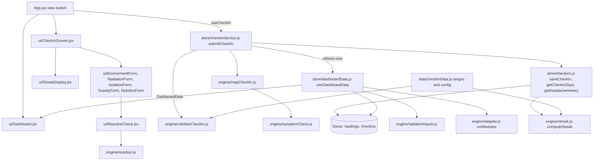
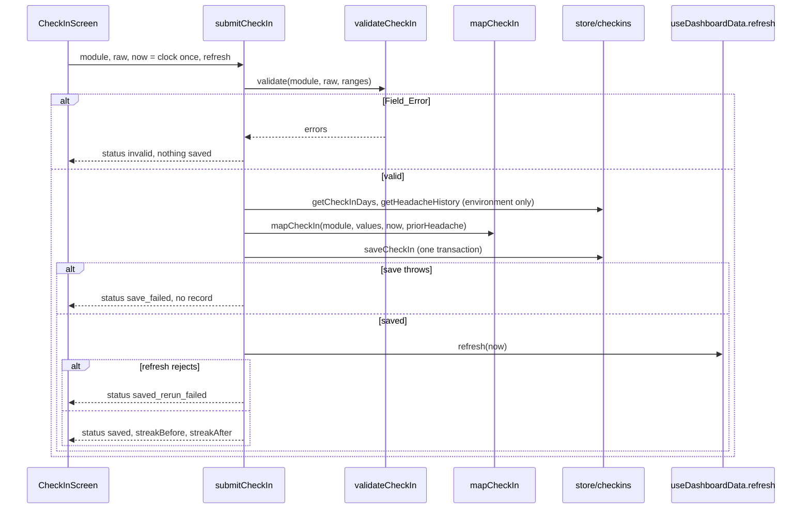

# Design Document

## Overview

The check-in is a screen where the astronaut answers one short form per module. A submit validates the form, maps it to Readings, saves the Readings and a Check_In_Record in one Dexie transaction, and then re-runs the engine so the Dashboard alerts update. A streak counter rewards completing the check-in and never looks at a reading value or an alert status.

The check-in adds no scoring logic. It changes no `rules.json` band, no Radiation engine rule and no `cutoffs.json` value. It reuses `validateReading`, `saveReading`'s validation, `runModules`, `loadCutoffs` and the Dashboard's `DashboardData` contract.

Stack: React, Vite, JavaScript only, Tailwind CSS, Dexie, Vitest. fast-check and fake-indexeddb are already dev dependencies. Component tests use `@testing-library/react`, `@testing-library/user-event` and `jsdom`, which the dashboard spec adds. Nothing in the check-in makes a network request.

### What the existing code looks like (findings that shape the design)

| Finding | Consequence |
| --- | --- |
| `store/db.js` has `db.version(1).stores({ readings: '++id, [domain+indicator+timestamp], timestamp' })`. | Add `db.version(2)` with a new `checkins` table. Dexie carries unchanged tables forward, so `readings` and its data are untouched. A test opens a v1 database holding a Reading and then opens v2. |
| `saveReading` validates and strips to four fields, `getReadings` returns rows without `id`. Readings carry no module tag. | The Check_In_Record stores the ids of the Readings it wrote (`readingIds`). Replace-on-resubmit deletes exactly those ids. Readings from the simulated scenario on the same day are never touched, and the `readings` schema stays as it is. |
| `runModules(descriptors, readingsByDomain, ctx)` passes `readingsByDomain[domain]` to a `rules` module as `{ [indicator]: Reading[] }`, and to a `function` module as its only `readings` argument. | For `environment`, `gravity` and `nutrition` the caller builds `{ indicator: Reading[] }`. For `radiation` the caller passes the engine input object `{ cumulativeDose_mSv, premissionDose_mSv, protonFlux_pfu, symptoms }` built by the radiation input builder, because `modules/radiation/index.js` runs `evaluate(inputs)` directly. |
| Only `modules/radiation/index.js` exists. `environment`, `gravity`, `nutrition` have `rules.json` but no `index.js`. There is no `isolation` folder, no `store/dashboardData.js` and no `sim/` code yet. | The shared module list is built in one place (`data/moduleList.js`, see Components) with `defineModule({ kind: 'rules' })` for the three rules modules. Isolation is added when it exists. The check-in works without it. |
| `engine/` files are pure, take `now` and data as parameters and have a `*.test.js` beside them. | All check-in logic is in new `engine/` files that take ranges, config and `now` as parameters. They import no JSON, Dexie or React. |

### Design decisions

| Decision | Choice | Reason |
| --- | --- | --- |
| Where pure code lives | `baseline/src/engine/` with one test file beside each file. No `src/checkin/` folder. | The structure steering says pure functions with no UI code live in `engine/` and each needs a unit test. |
| Ranges and config | `data/checkinRanges.json` and `data/checkinConfig.json` are loaded by `data/checkinData.js` (static import, like `data/cutoffs.js`) and passed into the pure functions as arguments. | Requirement 7.2: the validator body holds no range constant. `engine/` imports no JSON. |
| Clock | The UI reads the clock once per submit and passes `now` (epoch ms) down. `engine/` never reads it. The Reaction_Check component uses `performance.now()` in `ui/`, because timing a tap is a UI concern. | Assumption 5. |
| Day key | `dayKeyOf(timestamp)` uses the local calendar date. Streak arithmetic uses `Date.UTC` on the parsed `YYYY-MM-DD`, so daylight-saving changes cannot skip or repeat a day. | Local day for the user, stable day arithmetic. |
| Yes or no values | Form state holds `true`, `false` or `null` (unanswered). Readings hold 1 or 0. | Requirement 7.8 needs "unanswered". |
| Number parsing | A field string is trimmed. Empty means "missing". It must match `/^[+-]?(\d+\.?\d*\|\.\d+)$/`, otherwise "not a number". This rejects `0x10`, `1e3`, `Infinity` and `NaN`. | `Number()` accepts strings that a person did not mean as numbers. |
| Replace on resubmit | Inside the transaction: find the record for `[dayKey+module]`, delete its `readingIds`, add the new Readings, then `put` the record with the new ids. | Requirement 9.4, 9.5. Exact, no query by time range. |
| Failure of the engine re-run | Only a rejected `refresh` counts as a re-run failure (Requirement 9.7). Per-module errors that `runModules` returns in its result are logged by the data hook, as in the dashboard design. | Keeps one definition of "engine error" for both screens. |
| Navigation | `App.jsx` holds `view: 'dashboard' \| 'checkin'` in state and renders one of the two screens. It owns the single `useDashboardData()` instance and passes `data` to the Dashboard and `refresh` to the check-in submit. | Assumption 10. No router. |
| Gap rule for property 10.11 | The "unchanged" metamorphic property adds a day at least two days before the first day of the current run. A day directly before the run extends the run by one. | Requirement 10.11 says "before the first day of the current run". The adjacent day would extend the streak, so the property is stated for a gap of at least one missing day. See the note under Correctness Properties. |

## Architecture



Layering rules (same as core and dashboard):

- `engine/` check-in files are pure: no Dexie, React, JSON import, `console`, clock or randomness. Randomness for the reaction wait is passed in as a number in [0, 1).
- `store/` is the only layer that imports Dexie. It imports pure `engine/` functions.
- `ui/` never imports Dexie or `store/`. `CheckInScreen` receives callbacks and data as props. `App.jsx` wires them.
- `data/` loads bundled JSON statically. There is no runtime fetch.

New and changed files:

```text
baseline/src/
  data/
    checkinRanges.json        field ranges, each with "source": "design value"
    checkinConfig.json        { "minModulesPerDay": 1, "reactionMinTaps": 5, "source": "design value" }
    checkinData.js            loadCheckinRanges(), loadCheckinConfig(): static import, validate, freeze
    moduleList.js             getModuleDescriptors(): radiation + defineModule(rules) for environment, gravity, nutrition
  engine/
    dayKey.js                 dayKeyOf, dayBounds, shiftDayKey
    validateCheckIn.js        validateCheckIn(module, raw, ranges)
    symptomCheck.js           deriveSymptomCode(answers, prior)
    mapCheckIn.js             mapCheckIn(module, values, ctx)
    radiationInputs.js        buildRadiationInputs(readingsByIndicator, now)
    reaction.js               medianReaction, summarizeReaction, nextWaitMs
    streak.js                 computeStreak(records, todayKey, minModules)
    *.test.js                 beside each file
  store/
    db.js                     CHANGED: add version(2) with checkins
    checkins.js               saveCheckIn, getCheckInDays, getHeadacheHistory
    checkinService.js         submitCheckIn(...) orchestration
    dashboardData.js          useDashboardData() exposes refresh(now) (dashboard spec file, extended)
    *.test.js                 fake-indexeddb tests
  ui/
    CheckInScreen.jsx, EnvironmentForm.jsx, RadiationForm.jsx, IsolationForm.jsx,
    GravityForm.jsx, NutritionForm.jsx, ReactionCheck.jsx, StreakDisplay.jsx,
    FormField.jsx             labelled input with error wiring
    checkinText.js            fixed strings
    *.test.jsx                jsdom component tests
```

`store/dashboardData.js` belongs to the dashboard spec and is not in the repository yet. The check-in tasks must build it as the dashboard design defines it, plus the `refresh(now)` function below. If the dashboard work lands first, the check-in only adds `refresh` and the radiation input builder call.

## Components and Interfaces

### data/checkinRanges.json and data/checkinData.js

```json
{
  "co2":         { "label": "Cabin CO2",          "unit": "mmHg",     "min": 0,   "max": 10,   "integer": false, "source": "design value" },
  "temperature": { "label": "Body temperature",   "unit": "deg C",    "min": 34,  "max": 42,   "integer": false, "source": "design value" },
  "sleep":       { "label": "Sleep",              "unit": "h",        "min": 0,   "max": 16,   "integer": false, "source": "design value" },
  "mood":        { "label": "Mood",               "unit": "",         "min": 1,   "max": 5,    "integer": true,  "source": "design value" },
  "exercise":    { "label": "Exercise sessions",  "unit": "sessions", "min": 0,   "max": 21,   "integer": true,  "source": "design value" },
  "intake":      { "label": "Food intake",        "unit": "%",        "min": 0,   "max": 150,  "integer": false, "source": "design value" },
  "reaction":    { "label": "Reaction time",      "unit": "ms",       "min": 100, "max": 2000, "integer": false, "source": "design value" }
}
```

`loadCheckinRanges()` and `loadCheckinConfig()` follow the `loadCutoffs()` pattern: static import, shape check that throws on a missing field, `min < max`, or a missing `source`, then cache and `Object.freeze`. A test confirms each range differs from the matching band limits in the `rules.json` files (Requirement 7.9).

### engine/dayKey.js

```js
dayKeyOf(timestamp)        // local 'YYYY-MM-DD' of an epoch-ms timestamp
dayBounds(dayKey)          // -> { start, end }  local midnight to next local midnight, end exclusive
shiftDayKey(dayKey, days)  // -> 'YYYY-MM-DD', pure calendar arithmetic with Date.UTC, negative days allowed
```

`dayKeyOf` formats `new Date(timestamp)` local fields. `dayBounds` builds `new Date(y, m - 1, d)` and the next day, so a 23 or 25 hour day is handled. Neither reads the clock.

### engine/validateCheckIn.js

```js
validateCheckIn(module, raw, ranges)
// module: 'environment' | 'radiation' | 'isolation' | 'gravity' | 'nutrition'
// raw (strings from inputs, booleans or null for yes/no):
//   environment: { co2, temperature, headache, nauseaFatigue }
//   radiation:   { symptoms: { nausea, vomiting, fatigue, skin, fever, bruising } }   // booleans
//   isolation:   { sleep, mood, reaction }     // reaction: '' or null when no Reaction_Check result
//   gravity:     { exercise }
//   nutrition:   { intake }
// -> { ok: true, values } | { ok: false, errors: [{ field, message }] }
```

`values` holds parsed numbers and booleans in the shape the mapper expects. Errors are listed in form order, so the UI focuses `errors[0].field`.

Per numeric field, in this order:

1. Empty after trim: `Enter a value for <label>.` (Requirement 7.3).
2. Not matching the number pattern: `<label> must be a number.` (7.4).
3. `integer` is true and the value is not an integer: `<label> must be a whole number.` (7.6).
4. Outside `[min, max]` (both inclusive): `<label> must be from <min> to <max> <unit>.` For a unit-less field the trailing space and unit are omitted, for example `Mood must be from 1 to 5.` (7.5).

For a yes or no field whose value is not `true` or `false`: `Choose yes or no.` (7.8). The Radiation form has no error case: unticked boxes are `false`. The `reaction` field is optional: an empty value is valid and gives `values.reaction = null`. A non-empty value is checked by rules 2 to 4.

Messages never call a value normal or abnormal (7.9). The labels, min, max and unit all come from `ranges`.

### engine/symptomCheck.js

```js
deriveSymptomCode({ headache, nauseaFatigue }, prior)
// prior: [yesterdayHeadache, dayBeforeHeadache]  booleans
// -> 0 | 1 | 2
```

```text
if nauseaFatigue                          -> 2   (Requirement 2.5)
else if headache and prior[0] and prior[1]-> 2   (2.6)
else if headache and (prior[0] or prior[1]) -> 1 (2.7)
else                                      -> 0   (2.8)
```

The 3-day persistence rule is a design value, recorded in a comment on this function.

### engine/mapCheckIn.js

```js
mapCheckIn(module, values, { now, priorHeadache })
// -> Reading[]   each { timestamp: now, domain, indicator, value }
```

| Module | Readings written (domain / indicator) |
| --- | --- |
| environment | `environment/cabin_co2_mmHg`, `environment/body_temperature`, `environment/headache_logged` (1 or 0), `environment/symptom_check` (from `deriveSymptomCode`) |
| radiation | `radiation/symptom_<key>` for each of `nausea`, `vomiting`, `fatigue`, `skin`, `fever`, `bruising`, value 1 or 0 (six Readings always) |
| isolation | `isolation/sleep_hours`, `isolation/mood`, `environment/sleep_hours` (same value), and `isolation/reaction_ms` only when `values.reaction` is not null |
| gravity | `gravity/exercise_sessions_per_week` |
| nutrition | `nutrition/intake_pct_of_plan` |

`priorHeadache` is only read for `environment`. The function returns plain objects. It does not validate, because `validateCheckIn` ran first. The service still passes every Reading through `validateReading` before saving, so a mapper bug cannot write a bad row (Requirement 8.3). The indicator names are exported constants in this file, and a test checks each against the `rules.json` files (8.2).

### engine/radiationInputs.js

```js
buildRadiationInputs(readingsByIndicator, now)
// readingsByIndicator: { [indicator]: Reading[] }  any order
// -> { cumulativeDose_mSv, premissionDose_mSv, protonFlux_pfu, symptoms: string[] }
```

For each indicator it takes the Reading with the greatest `timestamp <= now` (the last one in the list for equal timestamps).

- `cumulativeDose_mSv` from `cumulative_dose_mSv`, `premissionDose_mSv` from `premission_dose_mSv`, `protonFlux_pfu` from `proton_flux_pfu`. A missing Reading gives 0 (Requirement 3.5).
- `symptoms` is the list of keys, in the fixed key order, whose latest `symptom_<key>` Reading has value 1 (3.4).

It is a new file next to, not inside, `modules/radiation/radiation-engine.js`, which is not changed.

### engine/reaction.js

```js
medianReaction(times)            // non-empty number[] -> median (mean of the two middle values for even length)
summarizeReaction(times, minTaps) // -> { ok: true, median } | { ok: false, message: 'Not enough taps. Please run the reaction check again.' }
nextWaitMs(random)               // random in [0, 1) -> 2000 + random * 4000   (a value in [2000, 6000))
```

`medianReaction` sorts a copy. `summarizeReaction` fails when `times.length < minTaps` (from `checkinConfig.json`, 5). The component rounds the median to a whole millisecond before it goes into the form.

### engine/streak.js

```js
computeStreak(records, todayKey, minModules)
// records: [{ dayKey: string, module: string }]
// -> number
```

1. Group `records` by `dayKey` into sets of distinct module names. A day is counted when its set size is at least `minModules`.
2. Let `end = todayKey` if today is counted, else `shiftDayKey(todayKey, -1)`.
3. Count back from `end` one day at a time while the day is counted.

It takes only day keys and module names, so no Reading value or alert status can reach it (Requirement 10.5). A record dated after `todayKey` is ignored for the count (the loop starts at `end`).

### store/db.js (changed)

```js
db.version(1).stores({ readings: '++id, [domain+indicator+timestamp], timestamp' })
db.version(2).stores({ checkins: '++id, &[dayKey+module], dayKey' })
```

The version 1 line stays as it is. Dexie keeps `readings` in version 2. A `checkins` row is `{ id, dayKey, module, submittedAt, readingIds }`. The unique compound index `&[dayKey+module]` enforces one record per module per day (Requirement 9.5) at the database level.

### store/checkins.js

```js
saveCheckIn({ module, dayKey, now, readings })
// Promise<{ readingIds: number[] }>; one transaction on db.readings and db.checkins:
//   1. existing = checkins.get([dayKey, module])
//   2. if existing: db.readings.bulkDelete(existing.readingIds)
//   3. ids = db.readings.bulkAdd(readings, { allKeys: true })   // each Reading re-checked with validateReading
//   4. checkins.put({ ...(existing ? { id: existing.id } : {}), dayKey, module, submittedAt: now, readingIds: ids })
// Any thrown error rolls the whole transaction back (Requirement 9.1, 9.6).

getCheckInDays()                         // Promise<[{ dayKey, module }]>   all records, for computeStreak
getHeadacheHistory(dayKey)               // Promise<[boolean, boolean]>   for dayKey-1 and dayKey-2
```

`getHeadacheHistory` reads `environment/headache_logged` through the existing `getReadings` over the local-day range from `dayBounds(shiftDayKey(dayKey, -2)).start` to `dayBounds(dayKey).start`, then marks a day true when a Reading in that day has value 1. Because of replace-on-resubmit each day holds at most one such Reading. Readings in the range of today are not included.

### store/checkinService.js

```js
submitCheckIn({ module, raw, now, refresh })
// -> Promise<{
//      status: 'saved' | 'invalid' | 'save_failed' | 'saved_rerun_failed',
//      errors?: [{ field, message }],
//      streakBefore?: number, streakAfter?: number
//    }>
```

Steps, in order:



1. `dayKey = dayKeyOf(now)`. Validate. On errors return `invalid` and touch nothing (7.7).
2. Read `getCheckInDays()` and compute `streakBefore = computeStreak(days, dayKey, minModulesPerDay)`.
3. For `environment`, read `getHeadacheHistory(dayKey)`.
4. Map, then `saveCheckIn`. A thrown error returns `save_failed` (9.6). The transaction rolled back, so no Reading and no record exist.
5. Call `await refresh(now)`. A rejection returns `saved_rerun_failed` (9.7). The saved data stays.
6. Re-read the days and return `streakAfter`. The screen shows "Thank you for checking in." when `streakAfter > streakBefore` (10.7).

The service makes no network request (9.8) and reads no clock: `now` and `refresh` are arguments.

### How a submit re-runs the engine and updates the Dashboard

`store/dashboardData.js` already builds `DashboardData` (dashboard design) from stored Readings. The check-in extends it with a callable that does the same work for a given `now`:

```js
const { data, refresh } = useDashboardData()
// refresh(now): Promise<void>. Rebuilds DashboardData and replaces the hook state. Rejects if the build throws.
```

The build, shared by first load and `refresh`:

1. `cutoffs = loadCutoffs()`, `descriptors = getModuleDescriptors()`.
2. For each rules module (`environment`, `gravity`, `nutrition`, and later `isolation`): for each indicator in its `rules.json`, `getReadings({ domain, indicator })`, giving `readingsByDomain[domain] = { [indicator]: Reading[] }`. Isolation Readings are stored but have no descriptor yet, so they produce no alert.
3. For `radiation`: read the dose, flux and six symptom indicators with `getReadings`, and set `readingsByDomain.radiation = buildRadiationInputs(byIndicator, now)`.
4. `{ alerts, errors, warnings } = runModules(descriptors, readingsByDomain, { cutoffs, now })`.
5. Fill `readings`, `baselineStats` and `rules` of `DashboardData` exactly as the dashboard design describes, with `status: 'ready'`, and publish with `setState`. `errors` and `warnings` are logged by the hook.

The Dashboard receives the new `DashboardData` as a prop, so it re-renders without a page reload (Requirement 9.3). The check-in and the first load pass the same `now` semantics: the first load uses the clock reading taken by `App` at start-up, each submit uses its own submit time.

### ui components

`CheckInScreen` props: `{ onSubmit(module, raw) -> Promise<Result>, streak: { count, todayModules }, onShowDashboard, simulated: true }`. It keeps one `raw` state object per module, so values stay visible after a submit (1.5), and one result per module for the message.

| Component | Behaviour |
| --- | --- |
| `CheckInScreen` | Disclaimer banner (reuses the dashboard `SimulatedBanner` and its exact text), a switch button `min-h-11 min-w-11` with the label "Dashboard", `StreakDisplay`, and the five forms in the fixed order in a grid `grid-cols-1 lg:grid-cols-2`. A single `<div aria-live="polite">` repeats the latest confirmation or error text. |
| Module forms | Each is a `<form>` with its own submit button (`min-h-11`). Inputs go through `FormField`. Result text sits next to the form: "Saved. Alerts updated.", "Saved. Alerts could not be updated yet.", or "Could not save your check-in. Please try again." |
| `FormField` | A `<label htmlFor>` and an input. On error: the message in a `<p id>` below it, `aria-invalid="true"`, `aria-describedby` pointing at that id. Errors carry text and an icon, never colour alone. |
| Yes or no, mood, symptoms | Each set is a `<fieldset>` with a `<legend>`. Yes or no uses two radio buttons. Mood uses five radios labelled 1 to 5 with "Very low" at 1 and "Very good" at 5. Radiation uses six checkboxes. |
| Focus on error | After a result with `errors`, the form calls `focus()` on the element for `errors[0].field` (looked up by `id`). |
| `EnvironmentForm` | When `headache === true` shows the hint "A single day is saved to your history. Possible symptoms raise an alert when they repeat." |
| `IsolationForm` | Sleep input, mood radios, and `ReactionCheck`. The check reports `null` (skipped or too few taps) or a rounded median, stored in `raw.reaction`. |
| `ReactionCheck` | See below. |
| `StreakDisplay` | Shows "Check-in streak: N days", "Modules checked in today: M of 5" and "Simulated". Shows "Check-in streak: 0 days. Submit any form to start a streak." when the streak is 0 and nothing was submitted today. Shows "Thank you for checking in." when told the streak increased, and no text that rates health. |

Text constants are in `ui/checkinText.js`. The screen never builds clinical wording of its own, and it uses the word "possible" for symptoms and risk. The dashboard wording constants are reused for any mention of the 250 mSv value (Requirement 12.7), and the check-in itself does not show that value.

### ui/ReactionCheck.jsx

A small state machine in the component: `idle` → `waiting` → `prompt` → `waiting` … → `done`.

- Start button begins a 60 second window (`setTimeout`) and a hard stop at 120 seconds. Each wait uses `nextWaitMs(Math.random())`.
- A tap on the single focused button (click, Space or Enter all fire the button's click) in `waiting` shows "Too early. Wait for the prompt." and starts a new wait. A tap in `prompt` records `performance.now() - promptShownAt`, then starts a new wait.
- When 60 seconds have passed, the check ends after the current tap or wait: if the state is `prompt` it waits for the tap, if `waiting` it stops at once. The 120 second stop ends it in any case, so Requirement 5.4 holds even if the astronaut never taps.
- On end it calls `summarizeReaction(times, minTaps)`. On success it shows the median in ms and reports it to the form. Otherwise it shows the message and reports `null`.
- The prompt "Tap now" is rendered inside a `role="status"` `aria-live="polite"` region.
- "Skip reaction check" is a button that stops the timers and reports `null`.

Timers are cleared on unmount. Tests use Vitest fake timers and mock `performance.now`.

## Data Models

```js
Reading        = { timestamp: number, domain: Domain, indicator: string, value: number }   // core spec
CheckInRecord  = { id: number, dayKey: 'YYYY-MM-DD', module: 'environment'|'radiation'|'isolation'|'gravity'|'nutrition',
                   submittedAt: number, readingIds: number[] }                              // table checkins
FieldError     = { field: string, message: string }
Range          = { label, unit, min, max, integer, source: 'design value' }
CheckInResult  = { status: 'saved'|'invalid'|'save_failed'|'saved_rerun_failed', errors?, streakBefore?, streakAfter? }
```

Indexes of `checkins`: `++id`, unique `[dayKey+module]`, `dayKey`. Day keys are local dates, so a record belongs to the day the astronaut was on.

## Correctness Properties

*A property is a characteristic or behavior that should hold true across all valid executions of a system-essentially, a formal statement about what the system should do. Properties serve as the bridge between human-readable specifications and machine-verifiable correctness guarantees.*

Scope: the properties cover the pure `engine/` functions and the store with fake-indexeddb. Rendering, layout, focus, timers and contrast use example-based tests (see Testing Strategy).

Reflection: 2.2, 2.3, 4.2 to 4.5, 6.2, 6.4, 8.1, 8.3 and 8.4 all describe the mapper output and merge into Property 5 (shape and content) and Property 6 (readings by module). 2.4 to 2.8 merge into Property 7. 7.3 to 7.6 merge into Property 2, and 7.2 is included in it because the generator draws the ranges as input. 9.4, 9.5 and 10.1 merge into Property 11. 10.2 to 10.4 merge into Property 9 with a reference model. 3.5 and 4.5 are edge cases covered by generators in Properties 6 and 8.

### Property 1: Validation accepts exactly the in-range numbers

For any range definition, any field of that range and any finite number `n` written as a decimal string, `validateCheckIn` reports no error for the field if and only if `min <= n <= max` and, when `integer` is true, `n` is a whole number.

**Validates: Requirements 7.2, 7.5, 7.6**

### Property 2: Validation error messages follow the fixed templates

For any field and range, an empty or whitespace-only value gives exactly `Enter a value for <label>.`, a string that is not a decimal number gives exactly `<label> must be a number.`, a non-whole number for a whole-number field gives exactly `<label> must be a whole number.`, and an out-of-range number gives a message that contains the label, the minimum, the maximum and the unit. For any unanswered yes or no field the message is exactly `Choose yes or no.`. No message contains the words "normal" or "abnormal".

**Validates: Requirements 7.3, 7.4, 7.5, 7.6, 7.8, 7.9**

### Property 3: Format, validate and parse round trip

For any valid form values of any module, formatting them as raw form input (numbers as decimal strings, booleans as booleans), validating, and reading `values` returns values equal to the original.

**Validates: Requirements 7.2, 8.1**

### Property 4: Invalid input produces errors in form order and no values

For any raw form input with at least one invalid field, `validateCheckIn` returns `ok: false`, an error list ordered by the form field order with at most one error per field, and every errored field is one that is actually invalid.

**Validates: Requirements 7.3, 7.4, 7.5, 7.6, 7.8**

### Property 5: Mapped readings satisfy the Reading contract

For any module, any valid values, any `now` and any prior headache history, every Reading returned by `mapCheckIn` has the four fields `timestamp`, `domain`, `indicator`, `value`, has `timestamp` equal to `now`, has a finite numeric `value`, and passes `validateReading`.

**Validates: Requirements 8.1, 8.3, 8.4**

### Property 6: Each module writes its documented indicators and values

For any valid values: environment writes exactly `cabin_co2_mmHg`, `body_temperature`, `headache_logged` and `symptom_check` with the entered numbers and 1 or 0 for headache. Radiation writes exactly six `symptom_<key>` Readings, each 1 if and only if its box was ticked. Isolation writes `sleep_hours`, `mood`, an environment `sleep_hours` with the same value as the isolation one, and `reaction_ms` if and only if a reaction value was given. Gravity writes `exercise_sessions_per_week` and nutrition writes `intake_pct_of_plan`, each equal to the entered value.

**Validates: Requirements 2.2, 2.3, 3.2, 4.2, 4.3, 4.4, 4.5, 6.2, 6.4**

### Property 7: Symptom code follows the rule table

For any combination of nausea with fatigue, headache today and two prior headache flags, `deriveSymptomCode` returns 2 when nausea with fatigue is true or when headache and both prior days are true, returns 1 when headache and exactly one prior day is true and nausea with fatigue is false, and returns 0 otherwise. The result is always one of 0, 1 or 2, and changing a prior flag from false to true never lowers the result.

**Validates: Requirements 2.4, 2.5, 2.6, 2.7, 2.8**

### Property 8: Radiation input builder uses the latest readings

For any collection of Readings in any order and any `now`, `buildRadiationInputs` returns each of dose, premission dose and flux equal to the value of the latest Reading at or before `now` for that indicator, or 0 when none exists, and returns `symptoms` equal to the keys, in the fixed key order, whose latest `symptom_<key>` Reading at or before `now` has value 1.

**Validates: Requirements 3.4, 3.5**

### Property 9: Median is bounded and order independent

For any non-empty list of reaction times, `medianReaction` returns a value between the smallest and the largest time, and returns the same value for any permutation of the list. For any list with fewer than the minimum number of taps, `summarizeReaction` returns no median, and for any list with at least that many taps it returns `ok: true` with the median. For any random value in [0, 1), `nextWaitMs` returns a value of at least 2000 and below 6000.

**Validates: Requirements 5.1, 5.5, 5.8**

### Property 10: Streak matches a reference model

For any list of check-in records, any current day key and any minimum module count, `computeStreak` equals the count obtained by a simple reference model: count back from today (or from yesterday when today is not counted) while the day has at least the minimum number of distinct modules.

**Validates: Requirements 10.2, 10.3, 10.4**

### Property 11: Streak ignores order and duplicates

For any list of check-in records, any permutation of the list and any list with duplicate records added give the same Streak as the original.

**Validates: Requirements 10.10**

### Property 12: Streak metamorphic relations

For any list of records with a Streak greater than 0, adding a record for a day at least two days before the first day of the current run leaves the Streak unchanged, and adding a record on the day directly before the run increases it by exactly the length of the run that this day joins (at least 1). For any list in which the current day is not counted, adding the minimum number of module records for the current day increases the Streak by exactly 1.

**Validates: Requirements 10.11**

### Property 13: Streak does not depend on values or alert status

For any two sequences of valid form submissions on the same days for the same modules, with arbitrary different values, the Streak computed from the stored records is identical.

**Validates: Requirements 10.5, 10.12**

### Property 14: Save and read back round trip

For any module and valid values, saving the mapped Readings through `saveCheckIn` and reading each indicator back with `getReadings` returns Readings equal to the mapped Readings.

**Validates: Requirements 8.5, 9.1**

### Property 15: Resubmit replaces and leaves one set per day

For any module and any non-empty sequence of valid submits of that module on the same local day, the store holds exactly one Check_In_Record for that module and day, and for each Reading indicator that the module writes it holds exactly one Reading on that day, equal to the one from the last submit. Readings of other modules and other days, including Readings that `saveCheckIn` did not write, are unchanged.

**Validates: Requirements 9.4, 9.5, 10.1**

### Property 16: Invalid submit leaves the store unchanged

For any module and any raw input with at least one Field_Error, `submitCheckIn` returns `invalid` and the `readings` and `checkins` tables hold the same rows as before.

**Validates: Requirements 7.7**

### Property 17: Day key round trip

For any timestamp, `dayKeyOf(timestamp)` is a `YYYY-MM-DD` string, the timestamp lies within `dayBounds(dayKeyOf(timestamp))` (start inclusive, end exclusive), and for any day key and any number of days `n`, `shiftDayKey(shiftDayKey(key, n), -n)` equals the key.

**Validates: Requirements 10.1, 10.3, 2.6**

Note on 10.11: the requirement says a day "before the first day of the current run" leaves the Streak unchanged. A day directly adjacent to the run would extend it, so Property 12 states the unchanged case for a gap of at least one missing day. Requirement 10.11 could be reworded to "at least 2 days before the first day of the current run".

## Error Handling

| Situation | Behaviour |
| --- | --- |
| Field_Error in a form | Nothing is saved. Messages appear next to the fields, the first invalid field gets focus, and the live region announces the first message. Entered values stay. |
| Dexie write throws (quota, closed database) | The transaction rolls back. `status: 'save_failed'`, message "Could not save your check-in. Please try again.", values kept, no record. |
| `refresh` rejects | Readings and record stay. `status: 'saved_rerun_failed'`, message "Saved. Alerts could not be updated yet." The next successful submit or app start rebuilds the alerts. |
| `runModules` returns per-module errors | Logged by the data hook. Alerts of the failed module are absent. The check-in shows "Saved. Alerts updated." because the re-run itself completed. |
| No dose or flux Reading | The input builder uses 0 for that input (Requirement 3.5). |
| No Isolation module | Isolation Readings are stored. No Isolation alert appears. |
| Headache history unreadable | `getHeadacheHistory` rejects, the service treats it as a save failure and writes nothing. |
| Clock change, daylight-saving day | Day keys come from local dates and day arithmetic uses `Date.UTC`, so a 23 or 25 hour day counts as one day. |
| Submit twice quickly | The unique `[dayKey+module]` index and the single transaction make the second submit replace the first. The submit button is disabled while a submit is in flight. |
| Reaction check never tapped | The 120 second stop ends it with "Not enough taps. Please run the reaction check again." |

## Testing Strategy

Property-based testing applies to the pure `engine/` functions and to the store through fake-indexeddb. It does not apply to React rendering, layout, focus, timers, contrast or the form copy, which use example-based tests.

**Property tests (fast-check).** Each of Properties 1 to 17 is one `fc.assert(fc.property(...))` with at least 100 runs. Each has the comment `// Feature: checkin, Property N: <title>`. Store properties (14, 15, 16, 13) use `fake-indexeddb/auto`, clear both tables in `beforeEach`, and use a smaller `numRuns` of 100 with short sequences. Generators:

- Ranges: `min` and `max` integers with `min < max`, `integer` boolean, labels and units as short strings.
- Numeric strings: `fc.double({ noNaN: true, noDefaultInfinity: true })` formatted as decimal (no exponent), plus non-numeric strings from `fc.string()` filtered by the number pattern.
- Form values per module that lie inside the real `checkinRanges.json` ranges, whole numbers for mood and exercise.
- Records: arrays of `{ dayKey, module }` where `dayKey` is `shiftDayKey('2025-01-01', k)` for small `k`, `module` from the five names.
- Timestamps: integers over several years, and a pinned run in a timezone with daylight saving (the test sets `process.env.TZ` in a separate file).

Files: `dayKey.test.js`, `validateCheckIn.test.js`, `symptomCheck.test.js`, `mapCheckIn.test.js`, `radiationInputs.test.js`, `reaction.test.js`, `streak.test.js`, `checkins.test.js`, `checkinService.test.js`. Every exported function of the new `engine/` files has at least one unit test beside it (Requirement 13.2).

**Example-based unit tests (node).**

- Each Symptom_Check_Code rule with one concrete case (2.5 to 2.8), including the headache hint condition.
- Each Field_Error message, and every range at min, max, and just outside both (13.4), taken from `checkinRanges.json`.
- `checkinRanges.json` has every required number, unit and `"design value"` source (7.1), and differs from the band limits in the `rules.json` files (7.9).
- Indicator names used by the mapper exist in the `rules.json` files, except `headache_logged`, `symptom_<key>`, `reaction_ms` and `mood`, which are listed as check-in only (8.2).
- Source scan: the new `engine/` files import nothing from `ui/`, React, Dexie or JSON, contain no `console`, `Date.now`, `new Date()` without an argument or `Math.random`, and the validator contains no numeric range literal (7.2, 13.1).
- Source scan: the check-in files in `ui/` and `store/` contain no `fetch`, `XMLHttpRequest`, `http://` or `https://` (9.8, 12.5).

**Store tests (fake-indexeddb).**

- Schema upgrade: create a version 1 database with one Reading, open version 2, and check the Reading is still there and `checkins` exists.
- One transaction: make `db.checkins.put` throw and check that neither the new Readings nor a record exist, and that an earlier record and its Readings are still present (9.1, 9.6).
- Streak after restart: close and reopen the database and compute the same Streak (10.9).
- Offline: with `fetch` stubbed to throw, a submit still saves and calls `refresh` (12.4).
- `getHeadacheHistory` returns the right flags across a local midnight.

**Integration test.** Using fake-indexeddb, the real `runModules`, `getModuleDescriptors()` and `loadCutoffs()`: seed enough environment history for a ready baseline, then submit an Environment form with a CO2 value above the `act` band edge. Check that `environment_overall` changes from its earlier status, and that the Streak computed before and after that status change is the same for the same records (13.6). A second case submits only the Isolation form with no Isolation module in the descriptor list and checks that the Readings are stored and nothing fails (4.6). A third case spies on `refresh` and checks it is called once with the submit time, after the save (9.2). A fourth case makes `refresh` reject and checks the `saved_rerun_failed` result and that the data stays (9.7).

**Component tests (jsdom, Testing Library).**

- `CheckInScreen`: five forms in order with their titles and one submit button each, the banner text, the switch control classes `min-h-11 min-w-11`, the "Saved. Alerts updated." text next to the form and values still shown (1.1 to 1.5).
- Labels and groups: every input has an associated label, and the symptom checkboxes, mood radios and yes or no radios are inside a `fieldset` with a `legend` (11.1, 11.2).
- Errors: with a failing result, the field has `aria-invalid="true"` and an `aria-describedby` that points at the message, focus is on the first invalid field, and the live region contains the message (11.3, 11.4, 11.6).
- Keyboard: Tab reaches every control and pressing Enter in a field submits one form (11.5).
- Environment hint appears only when headache is yes (2.9). Radiation labels match the list in Requirement 3.1 and an untouched Radiation submit is accepted (3.3).
- `ReactionCheck` with fake timers: the prompt appears between 2 and 6 seconds after a mocked random value, an early tap shows "Too early. Wait for the prompt." and starts a new wait, the check ends after 60 seconds with a median, ends at 120 seconds with no tap, fewer than 5 taps give the message and no median, Space and Enter on the focused button record a tap, the prompt sits in a polite live region, and "Skip reaction check" reports no result (5.1 to 5.7).
- `StreakDisplay`: the three texts for streak N, zero streak, and increase (10.6 to 10.8), with the word "Simulated" present (12.6).

**Not covered by automated tests** because they are visual and need a real browser: single column at 360 px and two columns at 1280 px (12.1, 12.2), 16 px body text, contrast of the check-in colours (they reuse `statusStyle.js` constants that the dashboard tests already check), and the quality of the wording (1.6, 12.7). These are checked by hand with the network disabled.

**Commands.** Run `vitest --run` in `baseline/`. No new runtime dependency is needed. Dev dependencies come from the dashboard spec: `@testing-library/react`, `@testing-library/user-event`, `jsdom`.

### Requirements traceability

| Requirement | Satisfied by |
| --- | --- |
| 1.1 to 1.6 | `CheckInScreen`, forms, `checkinText.js` |
| 2.1 to 2.9 | `EnvironmentForm`, `symptomCheck.js`, `mapCheckIn.js` (Properties 6, 7) |
| 3.1 to 3.6 | `RadiationForm`, `mapCheckIn.js`, `radiationInputs.js` (Properties 6, 8) |
| 4.1 to 4.6 | `IsolationForm`, `mapCheckIn.js` (Property 6), integration test |
| 5.1 to 5.8 | `ReactionCheck`, `reaction.js` (Property 9) |
| 6.1 to 6.4 | `GravityForm`, `NutritionForm`, `mapCheckIn.js` (Property 6) |
| 7.1 to 7.9 | `checkinRanges.json`, `validateCheckIn.js` (Properties 1 to 4, 16) |
| 8.1 to 8.5 | `mapCheckIn.js`, `saveCheckIn` (Properties 3, 5, 14) |
| 9.1 to 9.8 | `checkins.js`, `checkinService.js`, `useDashboardData.refresh` (Properties 14 to 16) |
| 10.1 to 10.12 | `streak.js`, `checkins.js`, `StreakDisplay` (Properties 10 to 13, 15) |
| 11.1 to 11.7 | `FormField`, forms, `CheckInScreen` live region |
| 12.1 to 12.7 | Tailwind layout classes, `StreakDisplay`, source scans |
| 13.1 to 13.8 | File layout and the test plan above |
