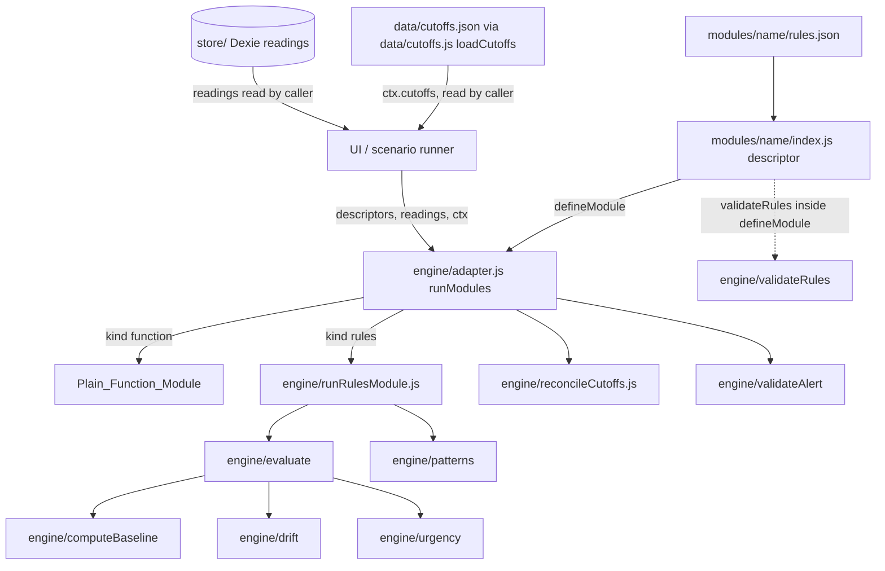

# Design Document

## Overview

The Driftwatch core is the shared engine every hazard module depends on. It stores readings in IndexedDB (Dexie), computes a personal baseline, evaluates each indicator against bands from `rules.json`, detects slow drift, scores urgency with shared cut-offs, detects combined patterns, and wraps plain-function modules (Radiation, Isolation) through a pure module adapter that validates the Alert contract.

All code lives in `driftwatch/src/`. The stack is JavaScript only, Dexie, Vitest, with fast-check for property tests and fake-indexeddb for store tests. No code in the core makes a network request.

Design decisions:

| Decision | Choice | Reason |
| --- | --- | --- |
| Where status comes from | The band gives the status. The urgency scorer then maps the status and a severity (0 to 1) into the urgency range of that status. | Keeps Requirement 3.1 (band selects status) and Requirement 5.4 to 5.6 (urgency maps to status) consistent by construction. |
| Cutoffs_File path | `driftwatch/src/data/cutoffs.json`, read by `driftwatch/src/data/cutoffs.js` | The engine stays pure: it receives cutoffs as a parameter and never imports JSON or Dexie. |
| Drift method | CUSUM on the z-score in the bad direction, with reference value `k` and threshold `h` | Simple, explainable, tunable from rules.json. |
| Timestamps | Integer or float epoch milliseconds | Sorting and window filtering need no parsing. |
| "Now" | Always passed in (`options.now`, `ctx.now`), never read from a clock inside engine functions | Pure, deterministic, testable. |
| Validation | Pure validators in `engine/` (`validateReading`, `validateAlert`, `validateRules`, `validateCutoffs`) reused by the store, loader and adapter | One definition of each contract. |
| Orchestration | `runRulesModule` and the adapter live in `engine/` as pure functions with no registry and no I/O | `modules/` holds only rules data and thin descriptors, as the structure rules require. |
| Band basis | The key family used in a band (`z_`, `abs_z_`, `value_`) selects the basis. There is no `basis` field. | Follows the key names in docs/development-plan.md and keeps one source of truth per band. |

Deviations and clarifications against docs/development-plan.md and requirements.md:

1. The plan's `patterns(alerts)` became `patterns(patternDefs, history, options)`. Testing `for_days` needs several days of history, so `history` is an array of per-day alert arrays, oldest first.
2. The plan's `evaluate(rule, readings)` takes a third `options` argument (`{ now, cutoffs, domain, indicator }`) because urgency needs the shared cut-offs and the evaluation time.
3. `computeBaseline(readings, windowDays)` keeps the plan's signature. Its third `options` argument is optional. When `options.now` is omitted, the latest reading timestamp is used as `now`. No clock is ever read.
4. Requirement 4.4 has been updated to 0.5 standard deviation and now matches the design. CUSUM with default `k = 0.5` and `h = 3` signals nothing while every bad-direction z is at or below `k`, and still detects a slow drift inside the 1 sd watch band before the band is crossed (Requirement 4.5).
5. Band keys follow the plan (`z_min`, `z_max`) with two added families, `abs_z_min`/`abs_z_max` and `value_min`/`value_max`.
6. Each module folder gets an `index.js` descriptor as listed in the plan, and `runRulesModule` and the adapter are in `engine/`, not `modules/`.

## Architecture



Layering rules:

- `engine/` holds pure functions only. It has no import from `ui/`, React, Dexie or JSON files, no clock, no console and no network access. This includes `runRulesModule`, the adapter and `reconcileCutoffs`.
- `store/` is the only layer that imports Dexie.
- `data/` loads and validates bundled JSON (`cutoffs.json`) and holds constants (`domains.js`).
- `modules/` holds only `<name>/rules.json` and `<name>/index.js`. An `index.js` imports its own rules.json (or a teammate engine file) and exports a descriptor. It contains no logic.
- The caller (UI or scenario runner) reads readings from the store, loads cutoffs once with `loadCutoffs()`, and passes both into `runModules`. The caller logs returned warnings and errors.

File layout:

```text
driftwatch/
  tests/                      scenario and integration tests (14-day scenario, offline run)
  src/
    data/
      cutoffs.json            { "watch_from": 30, "act_from": 60, "source": "design value" }
      cutoffs.js              loadCutoffs() only: static import, validate once, cache
      domains.js              DOMAINS, STATUSES
    engine/
      stats.js                mean, sample stdDev
      computeBaseline.js
      zScore.js
      drift.js                cusum, DRIFT_DEFAULTS
      evaluate.js
      urgency.js              urgency, statusFromUrgency, statusRank
      patterns.js
      reconcileCutoffs.js
      runRulesModule.js
      adapter.js              defineModule, runModules
      validateReading.js
      validateAlert.js
      validateRules.js
      validateCutoffs.js
      *.test.js               one test file beside each engine file
    store/
      db.js                   Dexie schema
      readings.js             saveReading, getReadings
    modules/
      <name>/rules.json
      <name>/index.js         module descriptor
```

Unit tests stay next to the engine file as `*.test.js`, so each function has its test beside it (Requirement 9.2). Scenario and integration tests (the shared 14-day scenario, the network-off run) go in the plan's `tests/` folder.

A module `index.js` exports one of:

```js
// rules module
import rules from './rules.json'
export default defineModule({ name: 'environment', domain: 'environment', kind: 'rules', rules })

// plain-function module wrapping a teammate engine file
import { runRadiation } from './radiation-engine.js'
export default defineModule({ name: 'radiation', domain: 'radiation', kind: 'function', run: runRadiation })
```

## Components and Interfaces

### store/readings.js

```js
saveReading(reading)                         // Promise<number>; rejects with ReadingValidationError
getReadings({ domain, indicator, windowDays, now })  // Promise<Reading[]> ordered oldest first
```

- Dexie schema: `readings: '++id, [domain+indicator+timestamp], timestamp'`.
- `saveReading` calls `validateReading` before any write. `ReadingValidationError` has `field` and `message`, and the message names the invalid domain or field.
- `getReadings` queries `[domain+indicator+timestamp]` with a range. When `windowDays` is given, the lower bound is `now - windowDays * 86_400_000` (inclusive). Results are returned without the auto-increment `id`.
- Tests use `fake-indexeddb/auto` so no browser is needed.
- Non-numeric indicators (symptom check, orthostatic symptoms) are stored as numbers: a 0/1 flag or a count of days. They use `value_min`/`value_max` bands.

### engine/computeBaseline.js

```js
computeBaseline(readings, windowDays, options = {}) // options: { now, minReadings = 5 }
// -> { ready: true, mean, sd, n } | { ready: false, n }
```

The plan's two-argument call `computeBaseline(readings, windowDays)` works unchanged. When `options.now` is omitted, `now` is the latest reading timestamp. Steps: keep readings with `timestamp >= now - windowDays*86400000`, sort a copy by timestamp, take values, compute mean and sample sd. If `n < minReadings` return `{ ready: false, n }` with no `mean` or `sd`. Sorting a copy and a numerically stable two-pass mean give order independence (Requirement 2.6). Callers exclude the reading under evaluation before calling (see `evaluate`).

### engine/zScore.js

```js
zScore(value, baseline, fallbackSpread = 1) // -> number, always finite
```

If `sd > 0`: `(value - mean) / sd`. If `sd === 0`: 0 when `value === mean`, otherwise `(value - mean) / fallbackSpread`. `fallbackSpread` comes from the indicator rule (`fallback_spread`), default 1 in the indicator's unit.

### engine/drift.js

```js
cusum(zSeries, { k = 0.5, h = 3 })
// zSeries: bad-direction z values, oldest first
// -> { drift: boolean, signalIndex: number | -1, runLength: number, statistic: number }
```

`C_t = max(0, C_{t-1} + z_t - k)`. Drift is signalled when `C_t > h`. `runLength` is the number of consecutive days since `C` last left zero, used in the `why` text. `signalIndex` is the first index where `C > h`. With every `z_t <= k`, `C` never grows, so no signal. A higher `h` can never move `signalIndex` earlier. `k` and `h` come from the indicator's `drift` block in rules.json (`{ "k": 0.5, "h": 3 }`), else the documented defaults exported as `DRIFT_DEFAULTS`.

### engine/evaluate.js

```js
evaluate(rule, readings, options) // options: { now, cutoffs, domain, indicator }
// -> Alert (exact contract fields)
```

1. Sort a copy of `readings`. The latest reading is the one being evaluated. The rest form the baseline pool.
2. `baseline = computeBaseline(pool, rule.baseline_days ?? 14, { now: options.now })`.
3. The key family of `rule.bands` gives the basis. `z_min`/`z_max` (the default) compare the signed z-score. `abs_z_min`/`abs_z_max` compare `|z|` (two-sided). `value_min`/`value_max` compare the raw value. If the baseline is ready, compute `z = zScore(...)`. If the baseline is not ready: use `rule.fallback_bands` (always `value_` keys) if present; a `value_` family rule uses its own bands; otherwise treat the result as `normal`. The `baseline` field of the alert is then `null` (Requirement 3.11).
4. Band lookup checks `act`, then `watch`, then `normal`. A band is `{ <family>_min?, <family>_max? }`; `_min` is inclusive and `_max` is exclusive.
5. Severity (0 to 1): for a band with both bounds, the depth into the band toward the worse end divided by the band width. For an open-ended band, depth divided by `rule.severity_span` (default 1 in basis units). `normal` has severity 0. The worse end is the lower end when `bad_direction` is `"low"`, and the higher end otherwise (for `abs_z_` bands it is always the higher end).
6. Drift: if the baseline is ready and the status is `normal`, build the bad-direction z series from the pool and the latest value (`low` flips the sign, `high` keeps it, `both` uses `|z|`), then run `cusum`. On a signal, status becomes `watch`, severity is `min(1, statistic / (2h))`, and `why` states that the cause is drift from the personal baseline over `runLength` days.
7. `urgency` is computed by `urgency(...)`, and `escalate = urgency >= cutoffs.act_from`.
8. `why` is the rule template with `{delta}` and `{unit}` filled (delta is `|value - mean|` rounded to 2 decimals, or the distance to the nearest band edge when baseline is null). `action` and `source` come from the rule. The `baseline` field is the baseline mean or `null`.

### engine/urgency.js

```js
statusFromUrgency(u, cutoffs)            // 'normal' | 'watch' | 'act'
statusRank(status)                       // 0 | 1 | 2
urgency(alert, context)                  // alert: { status }, context: { severity = 0, cutoffs }
```

Each status owns a range: `normal` 0 to `watch_from - 1`, `watch` `watch_from` to `act_from - 1`, `act` `act_from` to 100. `urgency = round(floor + clamp(severity, 0, 1) * (ceil - floor))`, clamped to 0..100. Therefore `statusFromUrgency(urgency(a, ctx), cutoffs) === a.status` for valid cutoffs. Non-finite severity is treated as 0.

### engine/patterns.js

```js
patterns(patternDefs, history, options) // options: { domain, cutoffs }
// history: Alert[][] per day, oldest first; patternDefs: rules.json "patterns"
// -> Alert[] (pattern alerts)
```

A pattern fires when, on each of the last `for_days` days, at least `min_in_watch` of the `needs` indicators have status `watch` or `act`. The alert has `indicator` equal to the pattern name, `domain` from `options.domain`, `status` from `result`, `urgency` equal to the floor of that status (`watch_from` or `act_from`), `escalate` from the pattern, `why` extended with the contributing indicator names, and `action`, `source` from the pattern, `value` the number of contributing indicators, and `baseline` `null`.

### engine/validate*.js

```js
validateReading(r)   // -> { ok: true } | { ok: false, field, message }
validateAlert(a)     // -> { ok: true } | { ok: false, field, message }; exact key set
validateRules(rules, moduleName) // throws RulesError { moduleName, indicator, key, message }
validateCutoffs(c)   // throws CutoffsError
```

`validateRules` checks:

- Top level: `module` is present and equals `moduleName` (the folder and module name). An optional `urgency` block (`watch_from`, `act_from`, `source`) is allowed and is not otherwise checked.
- Each indicator has the strings `label`, `unit`, `why`, `action`, `howToMeasure`, `whyItMatters`, and a `source` (string or `"design value"`). `bad_direction` is `low`, `high` or `both`.
- Each indicator has `normal`, `watch` and `act` bands. All three bands use the same key family (`z_`, `abs_z_` or `value_`). A mix of families across the three bands is rejected. Any key other than `<family>_min` and `<family>_max` is rejected as unknown. `fallback_bands`, when present, must use the `value_` family and the same three band keys.
- Each pattern has `needs`, `min_in_watch`, `for_days`, `result`, `escalate`, `why`, `action`, `source`, and every name in `needs` exists in `indicators`.

`validateCutoffs` rejects missing file content, non-finite numbers, and `watch_from >= act_from`. `cutoffs.json` uses the same three keys (`watch_from`, `act_from`, `source`) as the optional `urgency` block in rules.json.

### engine/reconcileCutoffs.js

```js
reconcileCutoffs(rules, cutoffs, moduleName) // -> { cutoffs, warnings: string[] }
```

Pure. Always returns the shared `cutoffs` object it was given. When `rules.urgency` exists and its `watch_from` or `act_from` differs from `cutoffs`, `warnings` has one string naming the module and the differing values. It does no logging.

### data/cutoffs.js

```js
loadCutoffs() // reads bundled cutoffs.json once, validates, caches, returns the frozen object
```

The JSON is bundled by Vite with a static import, so there is no runtime fetch. An invalid file throws at startup.

### engine/runRulesModule.js

```js
runRulesModule({ name, domain, rules }, readingsByIndicator, ctx) // ctx: { cutoffs, now }
// -> Alert[] : one per indicator, pattern alerts, and the overall alert
```

Pure and stateless. It runs `evaluate` per indicator, builds `history`, runs `patterns`, then builds the overall alert.

History construction: let `D` be the largest `for_days` among the patterns (at least 1). For `i` from `D - 1` down to 0, the day end is `dayEnd_i = ctx.now - i * 86_400_000`. For each day, take the readings with `timestamp <= dayEnd_i` and run `evaluate` with `now = dayEnd_i`. The resulting alert arrays, oldest first, are `history`. No clock is read.

Overall alert: `domain` is the module domain, `indicator` is exactly `<domain>_overall`, `status` is the highest rank among indicator and pattern alerts (this also covers Requirement 6.7), `urgency` is the maximum, `escalate` is `urgency >= cutoffs.act_from`, `value` is the count of non-normal alerts, `baseline` is `null`, `why` and `action` come from the highest-urgency alert, `source` is `"design value"`.

### engine/adapter.js

```js
defineModule(descriptor)
// descriptor: { name, domain, kind: 'function', run }  run(readings, ctx) -> Alert[]
//          or { name, domain, kind: 'rules', rules }
// -> frozen descriptor; throws on an invalid descriptor. For kind 'rules' it calls validateRules(rules, name).

runModules(moduleDescriptors, readingsByDomain, ctx) // ctx: { cutoffs, now }
// -> { alerts: Alert[], errors: ModuleError[], warnings: string[] }
```

There is no module-level registry and no state. The caller keeps the list of descriptors.

`runModules` behaviour:

- It takes `ctx.cutoffs` once (the caller gets it from `loadCutoffs()`) and passes the same object to every module, so every module uses identical cut-offs (Requirement 5.1).
- For a rules module it calls `reconcileCutoffs(rules, ctx.cutoffs, name)`, adds the returned warnings to the result `warnings`, and runs `runRulesModule` with the returned cutoffs (always the shared object).
- For a function module it calls `run(readings, ctx)` and does not alter what it returns.
- Each module runs inside try/catch (Requirement 8.7). Every alert is checked with `validateAlert`, and the module output must contain `<domain>_overall`. Valid alerts pass through unchanged (same values, Requirement 8.3). Invalid alerts are dropped from `alerts` and reported as `{ module, indicator, field, message }`. A thrown error becomes `{ module, error }` and the remaining modules still run.
- It never logs. The caller logs `warnings` and `errors`.

### Requirements traceability

| Requirement | Satisfied by |
| --- | --- |
| 1.1 | `store/readings.js` `saveReading` |
| 1.2 | `store/readings.js` `getReadings` (compound index, oldest first) |
| 1.3 | `store/readings.js` `getReadings` `windowDays` range |
| 1.4 | `engine/validateReading.js`, called by `saveReading` |
| 1.5 | `engine/validateReading.js`, called by `saveReading` |
| 1.6 | `store/readings.js` `saveReading` and `getReadings` together |
| 2.1 | `engine/computeBaseline.js` |
| 2.2 | `engine/computeBaseline.js` (`ready: false`) |
| 2.3 | `engine/evaluate.js` with `engine/zScore.js`, using `options.now` |
| 2.4 | `engine/zScore.js` (`fallbackSpread`) |
| 2.5 | `engine/evaluate.js` step 1 (latest reading removed from the pool) |
| 2.6 | `engine/computeBaseline.js` (sorted copy, stable mean) |
| 3.1 | `engine/evaluate.js` steps 3 and 4 |
| 3.2 | `engine/runRulesModule.js` |
| 3.3 | `engine/evaluate.js`, `engine/runRulesModule.js`, checked by `engine/validateAlert.js` |
| 3.4 | `engine/evaluate.js`, `engine/urgency.js` `statusFromUrgency` |
| 3.5 | `engine/urgency.js`, `engine/evaluate.js` step 7 |
| 3.6 | `engine/evaluate.js` step 7 |
| 3.7 | `engine/evaluate.js` step 8 |
| 3.8 | `engine/validateRules.js`, called by `defineModule` |
| 3.9 | `engine/validateRules.js`, called by `defineModule` |
| 3.10 | `engine/runRulesModule.js` overall alert |
| 3.11 | `engine/evaluate.js` step 3 (`fallback_bands`, `baseline: null`) |
| 4.1 | `engine/drift.js` `cusum`, used in `engine/evaluate.js` step 6 |
| 4.2 | `engine/evaluate.js` step 6 |
| 4.3 | `engine/evaluate.js` step 6 (`why` with `runLength`) |
| 4.4 | `engine/drift.js` (`C` stays at 0 when every z is at or below `k`) |
| 4.5 | `engine/drift.js` with default `k` and `h` |
| 4.6 | `engine/drift.js` parameters from the rule `drift` block or `DRIFT_DEFAULTS` |
| 5.1 | `data/cutoffs.js` `loadCutoffs`, `engine/adapter.js` `runModules` (`ctx.cutoffs`) |
| 5.2 | `data/cutoffs.json` |
| 5.3 | `engine/urgency.js` `urgency` |
| 5.4 | `engine/urgency.js` `statusFromUrgency` |
| 5.5 | `engine/urgency.js` `statusFromUrgency` |
| 5.6 | `engine/urgency.js` `statusFromUrgency` |
| 5.7 | `engine/reconcileCutoffs.js` |
| 5.8 | `engine/validateCutoffs.js`, called by `loadCutoffs` |
| 5.9 | `engine/urgency.js` (status ranges ordered by rank) |
| 6.1 | `engine/validateRules.js` pattern checks |
| 6.2 | `engine/patterns.js` |
| 6.3 | `engine/patterns.js` |
| 6.4 | `engine/patterns.js` |
| 6.5 | `engine/patterns.js` |
| 6.6 | `engine/validateRules.js` (`needs` names exist) |
| 6.7 | `engine/runRulesModule.js` overall alert |
| 7.1 | All of `engine/` is pure with local data only; `store/` uses IndexedDB |
| 7.2 | Static imports of rules.json and cutoffs.json; no network call in `engine/` |
| 7.3 | Same: `engine/` has no network access |
| 7.4 | Same: `engine/` output depends only on its arguments |
| 8.1 | `engine/adapter.js` `defineModule` (`kind: 'function'`) |
| 8.2 | `engine/adapter.js` `defineModule` and `runModules` (`kind: 'rules'`) |
| 8.3 | `engine/adapter.js` `runModules` pass-through |
| 8.4 | `engine/adapter.js` with `engine/validateAlert.js` |
| 8.5 | `engine/adapter.js` error report `{ module, indicator, field, message }` |
| 8.6 | `engine/adapter.js` overall alert check |
| 8.7 | `engine/adapter.js` try/catch per module |
| 9.1 | Layering rules; engine purity smoke test |
| 9.2 | `engine/*.test.js` beside each engine file |
| 9.3 | Property tests for Properties 4, 5, 13 to 17, 22 to 25 |
| 9.4 | `vitest --run` in `driftwatch/` |
| 9.5 | `fake-indexeddb/auto` in store tests |

## Data Models

```js
Reading  = { timestamp: number, domain: Domain, indicator: string, value: number }  // stored with auto id
Domain   = 'radiation' | 'isolation' | 'gravity' | 'environment' | 'nutrition' | 'system'
Status   = 'normal' | 'watch' | 'act'
Baseline = { ready: true, mean: number, sd: number, n: number } | { ready: false, n: number }
Alert    = { domain, indicator, value, baseline, status, urgency, why, action, escalate, source }
Cutoffs  = { watch_from: 30, act_from: 60, source: 'design value' }
```

Each indicator Alert has `indicator` equal to the indicator name. The overall Alert has `domain` equal to the module domain and `indicator` equal to `<domain>_overall`.

Standard deviation is the sample standard deviation (n - 1 divisor), consistent across all modules. With n >= 5 this is always defined.

Non-numeric indicators (symptom check, orthostatic symptoms) are stored as numbers, either a 0/1 flag or a count of days, and use `value_min`/`value_max` bands.

The rules.json shape follows docs/development-plan.md, with two added band key families (`abs_z_` and `value_`). Top level:

```json
{
  "module": "isolation",
  "urgency": { "watch_from": 30, "act_from": 60, "source": "design value" },
  "indicators": { "...": "..." },
  "patterns": { "...": "..." }
}
```

`module` is required and must equal the folder and module name. The `urgency` block is optional. It is ignored in favour of `data/cutoffs.json`, which uses the same three keys, and `reconcileCutoffs` warns when the values differ.

Indicator rule:

```json
{
  "label": "Sleep", "unit": "h", "bad_direction": "low",
  "baseline_days": 14, "fallback_spread": 0.5, "severity_span": 1,
  "bands": {
    "normal": { "z_min": -1.0 },
    "watch":  { "z_min": -2.0, "z_max": -1.0 },
    "act":    { "z_max": -2.0 }
  },
  "fallback_bands": {
    "normal": { "value_min": 6 },
    "watch":  { "value_min": 5, "value_max": 6 },
    "act":    { "value_max": 5 }
  },
  "drift": { "k": 0.5, "h": 3 },
  "why": "Sleep is {delta} {unit} below your usual.",
  "action": "Protect a full sleep period tonight.",
  "howToMeasure": "Log the hours you slept this morning.",
  "whyItMatters": "Short sleep slows reactions and lowers mood.",
  "source": "design value"
}
```

Key families:

| Family | Keys | Compared against |
| --- | --- | --- |
| z (default) | `z_min`, `z_max` | signed z-score |
| two-sided z | `abs_z_min`, `abs_z_max` | absolute z-score |
| fixed value | `value_min`, `value_max` | raw value (also used in `fallback_bands`) |

`_min` is inclusive and `_max` is exclusive. `label`, `unit`, `bad_direction`, `bands`, `why`, `action`, `howToMeasure`, `whyItMatters` and `source` are required. `baseline_days`, `fallback_spread`, `severity_span`, `fallback_bands` and `drift` are optional.

## Correctness Properties

*A property is a characteristic or behavior that should hold true across all valid executions of a system-essentially, a formal statement about what the system should do. Properties serve as the bridge between human-readable specifications and machine-verifiable correctness guarantees.*

Reflection: 1.1, 1.6 merge into one round trip. 3.3 to 3.5 merge into one contract property. 5.4 to 5.6 and 5.9 merge into one mapping property. 4.2 and 4.3 merge. 6.2 and 6.5 merge into an iff. 8.4 and 8.5 merge. 7.3 and 7.4 merge. 2.1 and 2.2 stay separate because they have different outputs.

### Property 1: Reading round trip

For any valid Reading, saving it and reading it back by domain and indicator returns a Reading equal to the original (ignoring the generated `id`).

**Validates: Requirements 1.1, 1.6**

### Property 2: Ordering and window

For any set of valid Readings saved in any order, and any window N and time `now`, `getReadings` returns exactly the Readings for that domain and indicator whose timestamp lies in `[now - N days, now]`, sorted oldest first.

**Validates: Requirements 1.2, 1.3**

### Property 3: Invalid readings are rejected with the field named

For any Reading with a domain outside the six values, or with a missing timestamp, missing indicator, or non-numeric value, `saveReading` rejects, the error names the offending field (or domain), and the store is unchanged.

**Validates: Requirements 1.4, 1.5**

### Property 4: Baseline statistics and readiness

For any array of Readings inside the window, `computeBaseline` returns `ready: true` with mean and sample sd equal to a reference computation when there are at least 5, and `ready: false` with no `mean` or `sd` when there are fewer than 5.

**Validates: Requirements 2.1, 2.2**

### Property 5: Baseline is order independent

For any array of Readings and any permutation of it, `computeBaseline` returns identical results.

**Validates: Requirements 2.6**

### Property 6: Evaluated reading is excluded from the baseline

For any series with a latest Reading, changing only the latest value leaves the baseline that `evaluate` reports unchanged.

**Validates: Requirements 2.5**

### Property 7: Z-score is finite and correct

For any baseline (including `sd = 0`) and any finite value, `zScore` returns a finite number; it equals `(value - mean) / sd` when `sd > 0`, is 0 when `sd = 0` and `value = mean`, and equals `(value - mean) / fallbackSpread` otherwise.

**Validates: Requirements 2.3, 2.4**

### Property 8: Status matches the band

For any valid indicator rule, any ready baseline and any value, the `status` returned by `evaluate` equals the status from a reference band lookup using the rule's key family (`z_` on the signed z-score, `abs_z_` on the absolute z-score, `value_` on the raw value, with `_min` inclusive and `_max` exclusive), unless drift raised a `normal` result to `watch`. When the baseline is not ready, `baseline` is `null` and the status comes from `fallback_bands` (or the rule's own `value_` bands) only.

**Validates: Requirements 3.1, 3.11**

### Property 9: Module output satisfies the Alert contract

For any valid rules file and any readings, `runRulesModule` returns exactly one alert per indicator plus one overall alert whose `indicator` is `<domain>_overall` and whose `domain` is the module domain. Every alert has exactly the ten contract fields, lower-case status in `normal|watch|act`, urgency a number in 0..100, boolean `escalate`, and the overall status equals the highest status among the indicator and pattern alerts.

**Validates: Requirements 3.2, 3.3, 3.4, 3.5, 3.10, 6.7**

### Property 10: Escalate follows the act cut-off

For any alert produced by the core, `escalate` is true if and only if `urgency >= act_from`.

**Validates: Requirements 3.6**

### Property 11: Text fields come from the rules

For any indicator rule and reading, the alert `why` contains the filled delta and unit with no unreplaced `{...}` placeholder, and `action` and `source` equal the rule's values for the selected band's indicator.

**Validates: Requirements 3.7**

### Property 12: Invalid rules are rejected at load time

For any valid rules file, removing an indicator's `source` makes `validateRules` throw an error naming that indicator; removing one of `normal`, `watch`, `act` throws an error naming the indicator and the missing key; mixing key families across the three bands, adding an unknown band key, removing `label`, `howToMeasure` or `whyItMatters`, or changing `module` so it differs from the module name each throw an error naming the indicator (or the module) and the key; adding a name to a pattern's `needs` that is not an indicator throws an error naming the pattern and the name.

**Validates: Requirements 3.8, 3.9, 6.6**

### Property 13: Drift is not signalled at or below the reference value

For any z series whose bad-direction values are all at or below `k`, `cusum` signals no drift.

**Validates: Requirements 4.4**

### Property 14: Drift is detected before the watch band is crossed

For any constant per-day step in the bad direction that is large enough to cross the watch band within the series, `cusum` signals drift on a day earlier than the first day the series falls in the watch band.

**Validates: Requirements 4.5**

### Property 15: Drift inside the normal band yields a watch with an explanation

For any series where `cusum` signals drift while the latest value is still in the `normal` band, `evaluate` returns status `watch`, and `why` mentions the personal baseline and the number of days of build-up.

**Validates: Requirements 4.2, 4.3**

### Property 16: Higher threshold never signals earlier

For any z series and any `h1 <= h2`, the first signal index under `h2` is not earlier than under `h1`, and the parameters used are those passed from the rule or the documented defaults.

**Validates: Requirements 4.6**

### Property 17: Urgency range and cut-off mapping

For any alert status, any severity and any valid cutoffs, `urgency` returns a number in 0..100 and `statusFromUrgency` of it equals the alert status. For all integers 0..100, `statusFromUrgency` returns `normal` below `watch_from`, `watch` from `watch_from` up to `act_from - 1`, `act` from `act_from`, and its rank never decreases as urgency increases.

**Validates: Requirements 5.3, 5.4, 5.5, 5.6, 5.9**

### Property 18: Cutoffs validation and precedence

For any cutoffs object that is missing, has a non-numeric value, or has `watch_from >= act_from`, `validateCutoffs` throws. For any rules file whose `urgency` block differs from the cutoffs, `reconcileCutoffs` returns the shared cutoffs object and a `warnings` array with one string that names the module; when the block is absent or equal, `warnings` is empty.

**Validates: Requirements 5.7, 5.8**

### Property 19: Pattern fires exactly when the rule is met

For any pattern definition and any alert history, `patterns` returns an alert for the pattern if and only if on each of the last `for_days` days at least `min_in_watch` of the `needs` indicators have status `watch` or `act`.

**Validates: Requirements 6.2, 6.5**

### Property 20: Pattern alert fields

For any pattern alert returned, `status` equals the pattern `result`, `escalate`, `action` and `source` equal the pattern's values, `domain` equals the module domain, and `why` names every contributing indicator.

**Validates: Requirements 6.3, 6.4**

### Property 21: Same output online and offline

For any readings and rules, running the full pipeline with `fetch` and `XMLHttpRequest` stubbed to throw produces results deeply equal to running it with them stubbed to succeed, and no call to either is made.

**Validates: Requirements 7.1, 7.2, 7.3, 7.4**

### Property 22: Plain-function alerts pass through unchanged

For any plain-function module returning contract-valid alerts, `runModules` returns alerts deeply equal to those the function returned, and the function receives the readings it was given.

**Validates: Requirements 8.3**

### Property 23: Invalid alerts are rejected with details

For any valid alert, mutating it by removing a field, adding a field, setting an invalid status, setting urgency outside 0..100, or setting a non-boolean `escalate` makes `runModules` reject it with a report naming the module, the indicator and the invalid field.

**Validates: Requirements 8.4, 8.5**

### Property 24: Missing overall alert is reported

For any module output with the `<domain>_overall` alert removed, `runModules` reports the module name and the missing overall alert.

**Validates: Requirements 8.6**

### Property 25: A throwing module does not stop the others

For any list of modules where some throw, `runModules` reports each thrower by name and still returns the alerts of every module that did not throw.

**Validates: Requirements 8.7**

## Error Handling

| Condition | Behaviour |
| --- | --- |
| Invalid Reading | `saveReading` rejects with `ReadingValidationError { field }`; nothing is written. |
| Invalid rules file | `defineModule` calls `validateRules`, which throws `RulesError` naming module, indicator and key; no descriptor is created. |
| Invalid descriptor (unknown `kind`, missing `run`, bad domain) | `defineModule` throws an error naming the module. |
| Invalid or missing cutoffs | `loadCutoffs` throws at startup with a description of the problem. |
| Rules cutoffs differ from shared | Shared cutoffs win; `reconcileCutoffs` returns a warning string naming the module; `runModules` returns it in `warnings` and the caller logs it. |
| Baseline not ready | `baseline` is `null`; fixed bands only; no drift. |
| `sd = 0` | `zScore` uses the fallback spread; never NaN or Infinity. |
| Non-finite severity | Treated as 0. |
| Invalid alert from a module | Alert dropped and reported `{ module, indicator, field, message }`. |
| Missing overall alert | Reported `{ module, error: 'missing <domain>_overall' }`. |
| Module throws | Caught, reported with the module name; other modules continue. |
| IndexedDB unavailable | `saveReading` and `getReadings` reject with the Dexie error; the engine still runs on readings passed in. |

## Testing Strategy

Property-based testing applies to the engine, validators, adapter and (with an in-memory database) the store, because they are pure or deterministic functions with large input spaces. It does not apply to rules.json content, the cutoffs file content, or UI; those use example tests and schema validation.

Libraries and setup:

- Vitest runs all tests (`vitest --run` for a single execution).
- fast-check is the property-based testing library (dev dependency, to be added with `npm i -D fast-check fake-indexeddb`).
- fake-indexeddb (`import 'fake-indexeddb/auto'` in store tests) provides an in-memory IndexedDB so store tests run without a browser (Requirement 9.5). Each test clears the `readings` table in `beforeEach`.

Rules for property tests:

- Each correctness property is implemented by one fast-check property test with at least 100 runs (`{ numRuns: 100 }` or higher).
- Each test carries a tag comment: `// Feature: core, Property N: <property text>`.
- Generators: reading arrays with finite numbers and timestamps, rules objects built from a valid template and then mutated for rejection cases, alert objects built from the contract and then mutated, history arrays of status values. Generators avoid NaN and Infinity unless the test is about non-finite handling.

Unit tests (example-based) sit next to each engine file as `*.test.js` and cover:

- Every exported function in `engine/` has at least one test (Requirement 9.2): `computeBaseline`, `zScore`, `cusum`, `evaluate`, `urgency`, `statusFromUrgency`, `statusRank`, `patterns`, `reconcileCutoffs`, `runRulesModule`, `defineModule`, `runModules`, `validateReading`, `validateAlert`, `validateRules`, `validateCutoffs`.
- `cutoffs.json` equals `{ watch_from: 30, act_from: 60, source: "design value" }` and is read once (Requirements 5.1, 5.2).
- `rules.json` pattern schema example (Requirement 6.1).
- A drift worked example: a slow ramp that stays in the normal band, with the expected `why` text.
- Band family examples: one rule per family (`z_`, `abs_z_`, `value_`) with inclusive `_min` and exclusive `_max` boundaries.
- Adapter examples: define one plain-function module and one rules module (Requirements 8.1, 8.2), and check that `runModules` passes the same cutoffs object to both.
- Engine purity smoke test: scan `engine/*.js` imports and assert none reference `ui/`, `react`, `dexie`, or a `.json` file, and that no file uses `console`, `fetch` or `Date.now` (Requirement 9.1).

Scenario and integration tests go in `driftwatch/tests/`: the shared 14-day scenario run through `runModules`, and the network-off run (Property 21).

Not automated: Requirements 9.2 to 9.5 are process requirements checked by running `vitest --run` in `driftwatch/` with zero failures. Manual check: load the built app with the network off.

`package.json` needs a `"test:run": "vitest --run"` script and the two dev dependencies above.
