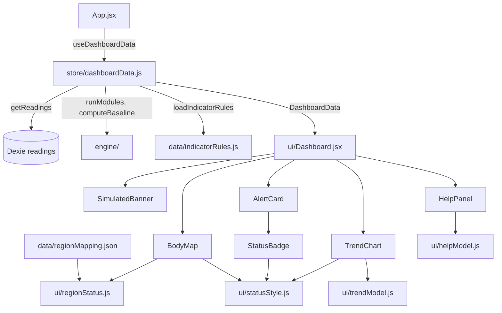

# Design Document

## Overview

The dashboard is the screen where an astronaut sees which body areas need attention and why. It is a read-only view over data the core already produces: Alerts from `runModules`, Readings from the Dexie store, and indicator text from each module's `rules.json`. It adds no engine logic. All code lives in `driftwatch/src/ui/`, with two small data files in `driftwatch/src/data/`.

Stack: React, Vite, JavaScript only, Tailwind CSS, Chart.js through react-chartjs-2, Vitest, fast-check. Tests for components add `@testing-library/react`, `@testing-library/user-event` and `jsdom` as dev dependencies. Nothing in the dashboard makes a network request. It uses a system font stack and bundles Chart.js.

### Design decisions

| Decision | Choice | Reason |
| --- | --- | --- |
| Region to domain mapping (assumption 1) | `driftwatch/src/data/regionMapping.json`: Head_And_Lungs = `radiation`, `environment`. Bones_And_Muscles = `gravity`. Whole_Body = `isolation`, `nutrition`, `system`. Mapping is by Alert `domain`, so `<domain>_overall` alerts follow their module. | Requirement 2.8 requires data, not constants. Mapping by domain keeps a new indicator in the right region with no UI change. |
| Missing modules | The dashboard only reads the Alerts it is given. A region with no mapped Alert shows "No data". The Isolation module is not in the repo yet, so Whole_Body shows nutrition (and system) alerts only until Isolation arrives. | Requirement 2.7. No special case for Isolation is needed. |
| Region status | Pure function `computeRegionStatus(alerts)` in `ui/regionStatus.js`. It reuses `statusRank` from `engine/urgency.js` by import and does not modify the engine. | Requirement 12.2. One definition of rank. |
| Baseline band (assumption 2) | Mean plus and minus one standard deviation. The mean is the Alert `baseline`. The sd comes from `baselineStats`, supplied by the app state layer (see below). | The Alert contract carries only the mean. The band must not be invented by the UI. |
| Data passing (assumption 4) | A `DashboardData` object is built outside `ui/` and passed to `Dashboard` as props. Components never import Dexie or call engine functions. | Keeps `ui/` presentational and testable with plain objects. |
| Colours and icons | One file, `ui/statusStyle.js`, holds the colour, icon shape, label and Tailwind classes for `normal`, `watch`, `act` and `nodata`. | Requirement 10.4. |
| Alert text | Rendered as supplied. No string building from `why`, `action` or `source`. | Requirement 5.6, 7.6, 8.1. |
| Chart tests | The chart data is built by a pure function `buildTrendModel`. Component tests mock `react-chartjs-2` because jsdom has no canvas. | Keeps the logic testable without a canvas. |
| Test environment | Component test files start with `// @vitest-environment jsdom`. Engine tests keep the default node environment. `vite.config.js` is unchanged. | Avoids touching the existing test setup. |

## Architecture



Layering rules:

- `ui/` imports React, Chart.js, `data/regionMapping.json`, `engine/urgency.js` (`statusRank` only) and its own files. It never imports Dexie, `store/`, or any other engine function.
- The pure helpers (`regionStatus.js`, `trendModel.js`, `helpModel.js`, `alertModel.js`, `statusStyle.js`) have no React or DOM import. Their tests are plain node tests.
- `store/dashboardData.js` is the only new file outside `ui/` that touches the engine and Dexie. It is a small hook that loads data and returns `DashboardData`. It contains no scoring logic. It calls the existing `getReadings`, `loadCutoffs`, `runModules` and `computeBaseline`.

File layout (new files only):

```text
driftwatch/src/
  data/
    regionMapping.json        regions, display names, domains per region
    indicatorRules.js         loadIndicatorRules(): static import of each module rules.json -> { "domain/indicator": rule }
  store/
    dashboardData.js          useDashboardData(): builds DashboardData
  ui/
    Dashboard.jsx             layout, selected region, open help, live region
    BodyMap.jsx
    AlertCard.jsx
    TrendChart.jsx
    HelpPanel.jsx
    StatusBadge.jsx
    SimulatedBanner.jsx       the permanent disclaimer banner
    statusStyle.js            shared colours, icons, labels
    regionStatus.js           pure: groupByRegion, computeRegionStatus, sortByUrgency, regionAccessibleName
    alertModel.js             pure: alertCardModel
    trendModel.js             pure: buildTrendModel
    helpModel.js              pure: helpSections
    wording.js                fixed strings, including REFERENCE_DOSE_TEXT
    *.test.js / *.test.jsx    beside each file
```

## Components and Interfaces

### Data passed in (settles assumption 4)

```js
DashboardData = {
  status: 'loading' | 'ready',
  alerts: Alert[],                                  // all modules, may be empty
  readings: { [key]: Reading[] },                   // key = `${domain}/${indicator}`, oldest first
  baselineStats: { [key]: { mean: number, sd: number } },   // absent when the baseline is not ready
  rules: { [key]: IndicatorRule },                  // from rules.json; absent for function modules
}
```

`useDashboardData` builds it as follows. It reads cutoffs with `loadCutoffs()`, reads Readings with `getReadings` for every indicator in `rules`, and calls `runModules`. For `baselineStats` it calls `computeBaseline` on all Readings except the latest, with the rule's `baseline_days` (default 14), which is the same pool `evaluate` uses. It keeps a `{ mean, sd }` only when `ready` is true. Alerts that `runModules` reports as errors are not shown. Errors and warnings are logged by this hook, not by `ui/`.

Radiation is a function module whose `rules.json` has no `indicators`. Its Alerts (`cumulative_dose`, `symptom_check_in`, `solar_proton_flux`) therefore have no entry in `rules`. The dashboard handles this: the Help_Panel shows "Not available" for each missing section (Requirement 7.5), and the Trend_Chart uses the Alert `indicator` as its label and no unit.

### data/regionMapping.json

```json
{
  "regions": [
    { "id": "head_and_lungs",    "name": "Head and lungs",    "domains": ["radiation", "environment"] },
    { "id": "bones_and_muscles", "name": "Bones and muscles", "domains": ["gravity"] },
    { "id": "whole_body",        "name": "Whole body",        "domains": ["isolation", "nutrition", "system"] }
  ]
}
```

The array order is the Tab order. Every value of `DOMAINS` appears in exactly one region. A test checks this against `data/domains.js`. An Alert whose domain is in no region is ignored by the map and logged once by the hook.

### ui/statusStyle.js

```js
STATUS_STYLE = {
  normal: { label: 'Normal', color: '#4ade80', icon: 'circle',   classes: '...' },
  watch:  { label: 'Watch',  color: '#fbbf24', icon: 'triangle', classes: '...' },
  act:    { label: 'Act',    color: '#f87171', icon: 'square',   classes: '...' },
  nodata: { label: 'No data', color: '#94a3b8', icon: 'dash',    classes: '...' },
}
statusLabel(status)   // 'normal' -> 'Normal'; null/undefined -> 'No data'
SURFACE = { background: '#0f172a', text: '#f1f5f9' }
```

The page uses a dark surface. All four colours and the text colour are chosen for at least 4.5:1 against `#0f172a` (the lightest of the four, `#4ade80`, is above 9:1, the darkest, `#94a3b8`, is about 6:1). A test computes the WCAG ratio from these constants (Requirements 10.1, 10.2). `BodyMap`, `StatusBadge` and `TrendChart` read colours only from this file. A source scan test checks that no hex colour appears in `ui/` outside `statusStyle.js` (Requirement 10.4). Icons are small inline SVG shapes drawn by `StatusBadge`: circle for Normal, triangle for Watch, square for Act, so each status has a distinct shape.

### ui/regionStatus.js (pure)

```js
groupByRegion(alerts, mapping)
// -> { [regionId]: Alert[] }  every region id present; each Alert goes to the region whose domains include alert.domain; others dropped

computeRegionStatus(alerts)
// -> { status: 'normal'|'watch'|'act'|null, escalate: boolean }
// status = alert status with highest statusRank, null for an empty array; escalate = alerts.some(a => a.escalate === true)

sortByUrgency(alerts)
// -> new array, urgency descending; ties keep input order (stable)

regionAccessibleName(regionName, status)
// -> `${regionName}: ${statusLabel(status)}`   e.g. "Head and lungs: Watch", "Head and lungs: No data"
```

No React or DOM import. `computeRegionStatus` uses `statusRank` from `engine/urgency.js`.

### ui/Dashboard.jsx

Props: `{ data: DashboardData, mapping = regionMapping }`. State: `selectedRegion` (id or null) and `helpTarget` (`{ key, openerEl }` or null). It renders:

1. `SimulatedBanner` at the top, always.
2. When `data.status === 'loading'`: the text "Loading data" and a `BodyMap` with no alerts (every region "No data").
3. A two-column grid at laptop width (`lg:grid-cols-2`), single column otherwise: `BodyMap` on the left, and on the right a `<section aria-live="polite">` holding the region panel (Requirement 4.6).
4. The region panel shows "Select a body region to see its alerts." when nothing is selected, "No alerts for this region yet." when the region has no Alert, otherwise one entry per Alert from `sortByUrgency`: an `AlertCard`, followed by a `TrendChart` for the same indicator. Overall alerts (`<domain>_overall`) show a card but no chart, since they have no Readings.
5. `HelpPanel` when `helpTarget` is set.

### ui/BodyMap.jsx

Props: `{ alertsByRegion, regions, selectedRegion, onSelect }`. It renders one inline `<svg viewBox="0 0 240 420">` with a drawn figure (no `<image>`, no raster). Regions are drawn as shapes, in this order in the DOM:

| Region | Shapes |
| --- | --- |
| Head and lungs | head circle and chest |
| Bones and muscles | both arms and both legs |
| Whole body | abdomen and pelvis band |

Each region is a `<g role="button" tabindex="0" aria-label="<name>: <Status_Label>" aria-pressed={selected}>` with `fill` from `STATUS_STYLE`, a 3 px outline, and a visible focus ring drawn with `:focus-visible` in the shared stylesheet. Enter and Space call `onSelect`, as does a click. Next to each region, an SVG `<text aria-hidden="true">` shows the region name, the Status_Label and, when `computeRegionStatus` reports it, "Escalate". A caption below the SVG reads "Simulated". The SVG is rendered at a minimum height of 360 px, so every region has a touch target above 44 by 44 CSS pixels.

Selected regions get a thicker outline in addition to `aria-pressed="true"` (Requirement 4.4).

### ui/AlertCard.jsx and ui/alertModel.js

```js
alertCardModel(alert, rule)
// -> { title, statusLabel, urgency, valueText, baselineText, why, action, source, escalate }
```

`title` is `rule.label` when a rule exists, otherwise the Alert `indicator` (for overall alerts: "Overall: <domain>"). `valueText` is the value with `rule.unit` when present. `baselineText` is "Baseline not ready" when `alert.baseline` is null, otherwise the baseline with the unit. `why`, `action` and `source` are the Alert strings with no change (so "design value" shows as is). The card shows the `StatusBadge`, "Simulated", the urgency, and a "Help" button (`min-h-11 min-w-11`) that opens the Help_Panel. When `escalate` is true it shows the Escalation_Notice text "Escalate: contact the flight surgeon or crew support." in a block with a distinct icon and border, otherwise it renders no notice.

### ui/TrendChart.jsx and ui/trendModel.js

```js
buildTrendModel({ alert, rule, readings, stats })
// -> { empty: boolean, title, statusLabel, unit, labels: string[], values: number[],
//      pointStyles: string[], band: { lower: number[], upper: number[] } | null,
//      baselineNotReady: boolean, altText: string }
```

- `labels` are readable local date/time strings from each Reading timestamp. `values` are the Reading values, oldest first.
- `pointStyles` has `'rectRot'` for the last point and `'circle'` for the others (Requirement 6.5).
- When `alert.baseline` is a number: `band.lower[i] = baseline - sd` and `band.upper[i] = baseline + sd`, where `sd = stats?.sd ?? 0`. With no stats the band collapses to a line at the baseline. When `alert.baseline` is null: `band` is `null` and `baselineNotReady` is true (the chart shows "Baseline not ready").
- `empty` is true when there are no Readings (the component then shows "No readings yet" instead of a chart).
- `altText` states the label, the latest value, the baseline value (or "baseline not ready") and the Status_Label.

`TrendChart` registers Chart.js `LineElement`, `PointElement`, `LinearScale`, `CategoryScale`, `Tooltip`, `Legend` and `Filler` and draws: the value line using the status colour of the latest alert, an invisible lower dataset, and an upper dataset labelled "Your baseline" with `fill: '-1'` so the shaded band lies between them. The legend filter hides the lower dataset, so "Your baseline" appears once. The y axis title is the rule `unit`. Options set `responsive: true` and `maintainAspectRatio: false` inside a container with a fixed height, so the chart resizes with its container (Requirement 9.5). The canvas has `role="img"` and `aria-label={altText}`. The title row shows the label, the Status_Label and "Simulated".

### ui/HelpPanel.jsx and ui/helpModel.js

```js
helpSections(rule)
// -> { label, sections: [ { heading: 'How to measure', text }, { heading: 'Why it matters', text },
//                         { heading: 'What to do', text }, { heading: 'Source', text } ] }
```

`text` is `rule.howToMeasure`, `rule.whyItMatters`, `rule.action`, `rule.source` unchanged when each is a non-empty string, and "Not available" otherwise (including when `rule` is undefined). `HelpPanel` is a non-modal `<aside role="dialog" aria-labelledby>` on the right on laptops and under the cards on phones. On open it moves focus to its heading (`tabIndex={-1}`). On Escape it calls `onClose`, and `Dashboard` returns focus to the saved opener element. A close button (`min-h-11 min-w-11`) is also provided.

### ui/StatusBadge.jsx and ui/SimulatedBanner.jsx

`StatusBadge({ status })` renders the icon shape, the Status_Label text and the colour from `STATUS_STYLE`. `SimulatedBanner` renders the fixed text "Simulated data. Decision support only, not a medical device." in a full-width bar with no buttons. It is rendered by `Dashboard` outside any conditional.

### ui/wording.js

```js
export const DISCLAIMER = 'Simulated data. Decision support only, not a medical device.'
export const REFERENCE_DOSE_TEXT = 'NASA design requirement for a reference solar particle event'
export const CAREER_DOSE_TEXT = 'NASA career effective dose requirement'
```

These are the only places where the dashboard's own text may relate to 250 or 600 mSv. The dashboard does not currently display either value itself. If a later screen needs to, it uses these constants. A source scan test checks that the digits `250` do not appear in `ui/` outside this file (Requirements 8.2 to 8.4).

### Responsive and accessibility notes

- Tailwind classes: page `grid grid-cols-1 lg:grid-cols-2 gap-4`, base text 16 px (`text-base`), all buttons `min-h-11 min-w-11` (44 px). `lg` is 1024 px, so Laptop_Width (1280) is two columns and Phone_Width (360) is one. Chart containers use `w-full` and `overflow-x-hidden` on the page.
- Focus styles use a 3 px outline in `SURFACE.text` colour, which is more than 3:1 against the region fills and the dark surface.
- Colour is never the only signal: every region and badge has a text label, and statuses have distinct icon shapes.

## Data Models

```js
Region = { id: string, name: string, domains: Domain[] }
RegionSummary = { status: 'normal' | 'watch' | 'act' | null, escalate: boolean }
IndicatorRule = { label, unit, howToMeasure, whyItMatters, action, source, ... }   // as in core rules.json
```

`Alert`, `Reading`, `Domain` and `Status` are as defined in the core design and are not changed.

## Correctness Properties

*A property is a characteristic or behavior that should hold true across all valid executions of a system-essentially, a formal statement about what the system should do. Properties serve as the bridge between human-readable specifications and machine-verifiable correctness guarantees.*

Scope: properties apply to the pure helpers (`regionStatus.js`, `alertModel.js`, `trendModel.js`, `helpModel.js`). Rendering, layout, focus handling, contrast and offline behaviour are covered by example-based component tests in the Testing Strategy.

Reflection: 3.1 and 2.4 overlap on status labels, so the label rule is folded into Property 5. 5.2 and 5.6 merge into Property 7. 7.5 and 7.6 merge into Property 10. 3.2 stays a separate property because it concerns `escalate`, not status. Property 3 (adding a lower or equal Alert) and Property 2 (order) are not implied by Property 1 as an implementation, because they would catch an implementation that uses the first or last Alert.

### Property 1: Highest status wins

For any array of Alerts, `computeRegionStatus` returns a status equal to the status with the highest rank (`act` above `watch` above `normal`) among them, and returns `null` for an empty array.

**Validates: Requirements 2.7, 3.1**

### Property 2: Region status is order independent

For any array of Alerts and any permutation of it, `computeRegionStatus` returns the same status and the same `escalate` value.

**Validates: Requirements 3.4**

### Property 3: Adding a lower or equal Alert leaves the status unchanged

For any non-empty array of Alerts and any extra Alert whose status rank is less than or equal to the current region status rank, `computeRegionStatus` of the extended array has the same status as before.

**Validates: Requirements 3.3**

### Property 4: Escalate is true if any Alert escalates

For any array of Alerts, `computeRegionStatus(...).escalate` is true if and only if at least one Alert has `escalate === true`.

**Validates: Requirements 3.2**

### Property 5: Grouping follows the mapping and labels are consistent

For any array of Alerts and the region mapping, `groupByRegion` places each Alert whose domain is mapped in exactly the region whose `domains` list contains that domain, places no other Alert, and loses none. For any region name and status (including `null`), `regionAccessibleName` equals the name, a colon and a space, then the capitalised Status_Label, or "No data" for `null`.

**Validates: Requirements 2.4, 2.5, 4.3**

### Property 6: Alerts for a region are sorted by urgency

For any array of Alerts, `sortByUrgency` returns a permutation of the input in which urgency never increases from one position to the next.

**Validates: Requirements 5.1**

### Property 7: Alert card text is passed through unchanged

For any Alert and any indicator rule (or none), `alertCardModel` returns `why`, `action` and `source` strictly equal to the Alert values, returns a `baselineText` equal to "Baseline not ready" if and only if `alert.baseline` is null, and includes the Status_Label and the urgency value.

**Validates: Requirements 5.2, 5.3, 5.6, 5.7**

### Property 8: Baseline band is centred on the baseline with width of two standard deviations

For any non-null baseline, any sd greater than or equal to 0 and any non-empty list of Readings, `buildTrendModel` returns a band with one lower and one upper value per Reading, where each upper minus lower equals twice the sd and each midpoint equals the baseline. For a null baseline the band is `null` and `baselineNotReady` is true.

**Validates: Requirements 6.3, 6.4**

### Property 9: Exactly the latest point is marked

For any non-empty list of Readings, `buildTrendModel` returns `values` equal to the Reading values in order, with one point style per Reading, and the style of the last point differs from all others, which are all equal to each other.

**Validates: Requirements 6.5**

### Property 10: Help text is exact or "Not available"

For any indicator rule (including `undefined` and rules with any of the four text fields missing or empty), `helpSections` returns four sections with the headings "How to measure", "Why it matters", "What to do" and "Source", in this order, whose text equals the rule field when it is a non-empty string and "Not available" otherwise.

**Validates: Requirements 7.2, 7.5, 7.6**

### Property 11: Text alternative states the key facts

For any Alert and any Readings, the `altText` from `buildTrendModel` contains the indicator label, the latest value, the baseline value (or the words "baseline not ready" when null) and the Status_Label.

**Validates: Requirements 6.6**

## Error Handling

| Situation | Behaviour |
| --- | --- |
| Alerts not yet loaded | `status: 'loading'`. Shows "Loading data" and every region as "No data". |
| Domain with no module in the repo (for example Isolation) | No Alert, so no data. The region shows what it has. |
| Alert domain not in the mapping | Dropped from the map. The hook logs one warning. |
| Indicator has no rule (radiation, or an unknown indicator) | Card uses the Alert `indicator` as title. Help shows "Not available" per section. Chart has no unit. |
| No Readings for an indicator | Chart area shows "No readings yet". |
| `baseline` is null | Card shows "Baseline not ready". Chart has no band and shows the same text. |
| Baseline present but no `baselineStats` | The band collapses to a single line at the baseline. |
| `runModules` returns errors | The hook logs them. Alerts from failed modules are simply absent, so those regions show "No data". |
| Dexie read fails | The hook keeps `status: 'loading'` off and returns an empty `DashboardData` with `status: 'ready'`, and logs the error. The banner still shows. |
| Help opener element removed before close | `Dashboard` skips the focus restore if the element is no longer in the document. |

## Testing Strategy

Property-based testing applies to the pure helpers, which have clear inputs and outputs. It does not apply to React rendering, layout, CSS, focus handling or the Chart.js canvas, which use example-based component tests instead.

**Property tests (fast-check, already installed).** Each of Properties 1 to 11 is implemented as a single `fc.assert(fc.property(...))` with at least 100 runs (`{ numRuns: 100 }` or more). Each test has a comment in the form `// Feature: dashboard, Property N: <title>`. Generators: Alerts with a status from `normal|watch|act`, urgency 0 to 100, boolean `escalate`, any domain from `DOMAINS` (and, for Property 5, unmapped strings), arbitrary strings for the text fields, and finite numbers for values and baselines. Files: `regionStatus.test.js`, `alertModel.test.js`, `trendModel.test.js`, `helpModel.test.js`.

**Example-based unit tests** (node):

- `regionMapping.json` has three regions in the order Head_And_Lungs, Bones_And_Muscles, Whole_Body, and every value of `DOMAINS` appears exactly once (Requirement 2.8).
- `statusStyle`: the three status styles have distinct colours and icon shapes, and the WCAG contrast ratio of each colour and the text colour against `SURFACE.background` is at least 4.5 (Requirements 10.1 to 10.3).
- Source scans of `ui/`: no hex colour outside `statusStyle.js` (10.4), no `250` or `600` outside `wording.js` (8.2 to 8.4), no `http://` or `https://` string and no `fetch` or `XMLHttpRequest` (11.2), and `regionStatus.js` imports no React or DOM module (12.2).

**Component tests** (jsdom, Testing Library, `react-chartjs-2` mocked):

- `SimulatedBanner`: exact text, no button, always rendered by `Dashboard` (1.1, 1.3). `AlertCard`, `TrendChart` and `BodyMap` show "Simulated" (1.4).
- `BodyMap`: inline SVG with no `img` element; exactly three `role="button"` regions; for each of `normal`, `watch`, `act`, the Status_Label text and the accessible name (for example "Head and lungs: Watch") are present; "No data" for a region without Alerts; "Escalate" text when an Alert escalates; rerender with new Alerts updates labels; Tab order matches the mapping order; Enter and Space select; `aria-pressed` is true on the selected region (2.1 to 2.7, 3.2, 4.1 to 4.4, 12.4).
- `AlertCard`: Escalation_Notice present when `escalate` is true and absent when false; "Baseline not ready" when baseline is null; the Help button opens the panel (5.2 to 5.5, 7.1, 12.5).
- `Dashboard`: initial text "Select a body region to see its alerts."; selecting a region with no Alerts shows "No alerts for this region yet."; selecting a region shows cards ordered by urgency; the region panel container has `aria-live="polite"`; `status: 'loading'` shows "Loading data" and all regions "No data"; rendering with `fetch` stubbed to throw succeeds (offline) (4.6, 5.1, 5.8, 5.9, 11.1, 11.3).
- `HelpPanel`: four headings with the rule text; focus moves into the panel on open; Escape closes and returns focus to the opener (7.2 to 7.5).
- `TrendChart`: "No readings yet" with no Readings; "Baseline not ready" with null baseline; the options passed to the mocked Line have `responsive: true`, the unit as y axis title, and a legend entry "Your baseline" (6.1, 6.2, 6.4, 6.7, 9.5).
- Interactive controls carry the `min-h-11` and `min-w-11` classes (9.3).

**Not covered by automated tests** because they are visual and depend on a real browser: single column and two column layout (9.1, 9.2), 16 px body text (9.4), banner visibility at both widths (1.2), wording quality (8.1, 8.5) and bundled Chart.js (6.8). These are checked by hand in the browser at 360 px and 1280 px widths and with the network disabled.

**Commands.** Add dev dependencies `@testing-library/react`, `@testing-library/user-event` and `jsdom`. Run `vitest --run` in `driftwatch/`.

### Requirements traceability

| Requirement | Satisfied by |
| --- | --- |
| 1.1 to 1.4 | `SimulatedBanner`, "Simulated" labels in `AlertCard`, `TrendChart`, `BodyMap` |
| 2.1 to 2.8 | `BodyMap`, `regionStatus.js`, `regionMapping.json`, `statusStyle.js` |
| 3.1 to 3.4 | `computeRegionStatus` (Properties 1 to 4) |
| 4.1 to 4.6 | `BodyMap` roles and keys, `regionAccessibleName`, live region in `Dashboard` |
| 5.1 to 5.9 | `Dashboard`, `sortByUrgency`, `AlertCard`, `alertCardModel` |
| 6.1 to 6.8 | `TrendChart`, `buildTrendModel` |
| 7.1 to 7.6 | `HelpPanel`, `helpSections`, focus handling in `Dashboard` |
| 8.1 to 8.5 | `wording.js`, pass-through of Alert and rule text, source scan tests |
| 9.1 to 9.5 | Tailwind layout classes, `min-h-11 min-w-11`, responsive chart options |
| 10.1 to 10.4 | `statusStyle.js`, `StatusBadge` |
| 11.1 to 11.3 | Props-only components, no network code, loading state |
| 12.1 to 12.6 | File layout, pure helpers, tests listed above |
