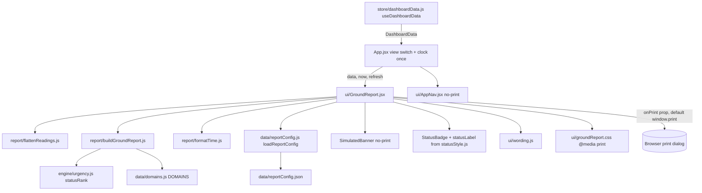

# Design Document

## Overview

The Ground_Report is a one-page summary of the last 7 days that the astronaut prints or saves as PDF when the link to Earth opens. A pure function, `buildGroundReport`, turns Alerts, Readings, indicator rules, a config object and a supplied `now` into a plain Report_Model. A React component, `GroundReport`, renders that model and offers a "Print or Save as PDF" button. A print stylesheet makes the same markup black on white and one page long.

The report adds no engine logic. It reads the data the dashboard hook already holds (`DashboardData`), so it needs no new store code and no Dexie import in `ui/`.

Stack: React, Vite, JavaScript only, Tailwind CSS, Vitest, fast-check. Component tests use `@testing-library/react`, `@testing-library/user-event` and `jsdom`, which the dashboard spec adds. Nothing in the report makes a network request.

### What the existing code looks like (findings that shape the design)

| Finding | Consequence |
| --- | --- |
| `driftwatch/src/App.jsx` is a stub that renders only the title. No `store/dashboardData.js`, `ui/` component, `statusStyle.js` or `SimulatedBanner` exists yet. The dashboard and check-in specs both plan to edit `App.jsx` and `dashboardData.js`. | The report depends on the dashboard contract (`DashboardData`, `statusStyle.js`, `StatusBadge`, `SimulatedBanner`, `wording.js`) and on the App view switch. Tasks for the report must run after dashboard task 7.2 and check-in task 7.7 (see Navigation and Sequencing risk). |
| `DashboardData` = `{ status, alerts, readings: { 'domain/indicator': Reading[] }, baselineStats, rules: { 'domain/indicator': IndicatorRule } }`. | `readings` is a map and the builder takes a flat array. A small pure helper `flattenReadings` does the conversion. `rules` is passed to the builder unchanged and is keyed the same way. |
| The dashboard hook reads Readings "for every indicator in `rules`". Radiation has no `indicators` in its `rules.json`, so its dose, flux and symptom Readings are not in `DashboardData.readings` as designed. | Without a change, Radiation would never show Last_Reading rows. The report task adds one step to `useDashboardData`: also load the radiation indicators (`cumulative_dose_mSv`, `premission_dose_mSv`, `proton_flux_pfu`, `symptom_*`) into `readings`. The check-in design already reads those same indicators for the engine, so this is the same list. Radiation rows then show the raw indicator name and no unit because no rule exists. |
| `statusStyle.js` holds `STATUS_STYLE` for `normal`, `watch`, `act` and `nodata` with colour, icon shape, label and classes, plus `statusLabel(status)`. `StatusBadge({ status })` draws the icon and the label. | The report reuses `StatusBadge` and `statusLabel` and defines no colour. A source scan test (dashboard task) forbids hex colours in `ui/` outside `statusStyle.js`, so the print stylesheet uses the keywords `black` and `white` only. |
| `engine/urgency.js` exports `statusRank` (`normal` 0, `watch` 1, `act` 2, unknown -1). | The builder imports `statusRank` for ranking instead of defining a second rank table. |
| `engine/` files each have a test beside them. `index.css` only imports Tailwind. | `report/` files follow the same rule: one test file beside each. The print stylesheet is a separate CSS file imported by the component. |

### Design decisions

| Decision | Choice | Reason |
| --- | --- | --- |
| Where the pure code lives | `driftwatch/src/report/` (development plan folder). It imports only `engine/urgency.js` and `data/domains.js`. | The development plan lists `report/`. `structure.md` only lists `engine/`, so `report/` is an addition that mirrors the `engine/` purity rules. |
| Builder signature | `buildGroundReport({ alerts, readings, rules, now, config })`. Requirement 1.1 lists four fields. `config` is a fifth, required field. | The caps and window length must be data (`reportConfig.json`) and `report/` must import no JSON. The caller passes the loaded config in, the same pattern as `loadCutoffs()` in core. A missing or invalid `config` throws `TypeError` because it is a programming error, not bad data. |
| Caps as data | `driftwatch/src/data/reportConfig.json` holds `windowDays` (7), `maxActiveAlertsPerModule` (6), `maxLastReadings` (12) and the six Module_Labels, with `"source": "design value"`. `data/reportConfig.js` exports `loadReportConfig()` (static import, validate, freeze, cache), like `loadCutoffs()`. | Requirement 8 says the design may adjust the caps once the layout is fixed. A data file lets the print check change them without code edits, and the repo rule is that limits carry a `source`. |
| Cap values | Set from the print-preview check: 6 Active_Alerts per module and 12 Last_Reading rows. With these values the 14-day demo (day 14) prints on one A4 page and one Letter page in Chrome and Edge. In print, Active alerts are set in two columns, the Why, Recommended action and Source parts of an entry run on as one paragraph, icons are 9pt high, line height is 1.1, and a `<domain>_overall` entry whose `why` and `action` repeat another alert of the same module word for word is not listed again (its status and urgency stay in the Module status table, and the model is unchanged). | See the page-fit analysis below: the worst case cannot fit one page at 9 pt, so any final value must come from looking at a real print preview of the 14-day scenario. |
| How the screen gets data | `GroundReport` takes `data` (a `DashboardData`), `now` and optional `config`, `onPrint`, `refreshing` props. It never imports Dexie or `store/`. `App.jsx` owns the single `useDashboardData()` instance. | Requirement 10.6. Same pattern as `Dashboard` and `CheckInScreen`. |
| Clock | `App.jsx` reads `Date.now()` once, when the user opens the report, and passes it as `now`. `GroundReport` and `buildGroundReport` never read the clock. | Requirement 6.4. The report does not change while it is open or being printed. |
| Fresh alerts | On opening the report, `App.jsx` calls `refresh(now)` from `useDashboardData` (added by the check-in spec) so Alerts match the same `now` as the window. The report shows "Loading data" and disables Print until `refresh` settles. If `refresh` is not present or rejects, the report is shown with the data already in memory. | Alerts have no timestamp (assumption 1), so they should be computed for the same `now` as the Report_Window. |
| Print approach | The Print_Button calls an `onPrint` prop that defaults to `() => window.print()`. A CSS `@media print` block hides everything marked `no-print` and restyles the sheet. Browsers offer "Save as PDF" in the same dialog. No PDF library. | Offline, no dependency, no bundle size. Injecting `onPrint` makes the click testable without jsdom's missing `window.print`. |
| Colours in print | The screen uses the dashboard dark surface and `StatusBadge`. The print block forces `black` text on `white`, strips fills and shows the status icon shape as solid black. The status is carried by text and icon shape, never by colour. | Requirements 9.6 and 9.7. The block uses colour keywords, not hex, so the "no hex outside `statusStyle.js`" scan still passes. |
| Status when a module has no alert | The builder returns `status: null` and `urgency: null`. The component displays `null` as "No data" using `statusLabel(null)` and `STATUS_STYLE.nodata`. | Same convention as the dashboard's `computeRegionStatus`. Requirement 2.2 says the status "is No data"; the model carries the absence and the label is a display concern. |
| Tie rule for readings | When two Readings of one indicator have equal `timestamp`, the one supplied last wins (Requirement 5.2). | See the note on a requirements conflict below. |
| Document title | While the report is mounted, `document.title` is `Driftwatch ground report <YYYY-MM-DD>` (local date of `now`). The previous title is restored on unmount. | Requirement 9.8. Browsers use the title as the default PDF file name. |

### Requirements notes found while designing

1. **Order independence vs "latest supplied last" (Requirements 1.2 and 5.2).** If two Readings of one indicator have the same `timestamp` and different values, the output depends on input order, so both requirements cannot hold for that input. The design keeps 5.2 for that single case and states Property 6 (order independence) for inputs in which no two Readings share `domain`, `indicator` and `timestamp`. Suggested rewording of 1.2: "...regardless of the order of the Alerts and Readings supplied, except for Readings of one indicator with equal timestamps".
2. **One page in the worst case (Requirements 8 and 9.5).** With caps 6 and 24 the content can exceed one page (see page-fit analysis). The design never clips or hides text to force a fit, because Requirement 3.4 and the escalation rule forbid dropping text. If the content is longer than a page it flows onto a second page. The caps and the compact layout make the demo scenario fit, and the manual check confirms it.
3. **Radiation Readings** are in the report only if the dashboard hook loads them (see findings table).

## Architecture



Layering rules:

- `report/` is pure: no React, no Dexie, no `console`, no clock, no JSON import, no randomness, no DOM. It imports only `engine/urgency.js` and `data/domains.js`.
- `ui/` imports `report/`, `data/reportConfig.js`, `statusStyle.js`, `StatusBadge`, `SimulatedBanner` and `wording.js`. It never imports Dexie or `store/`.
- `data/` loads bundled JSON statically. There is no runtime fetch.

New and changed files:

```text
driftwatch/src/
  data/
    reportConfig.json         windowDays, caps, moduleLabels, source "design value"
    reportConfig.js           loadReportConfig(): static import, validate, freeze, cache
    reportConfig.test.js
  report/
    buildGroundReport.js      pure builder
    flattenReadings.js        DashboardData.readings map -> flat Reading[]
    formatTime.js             formatDateTime(ts), dayKeyOf-style date for the title
    *.test.js                 beside each file, plus *.property.test.js per property
  ui/
    GroundReport.jsx          the screen (an addition to the ui/ list in structure.md)
    groundReport.css          @media print block and a few screen helpers
    AppNav.jsx                no-print navigation: Dashboard, Check-in, Ground report
    GroundReport.test.jsx, AppNav.test.jsx
  App.jsx                     CHANGED: view 'report', reportNow, open handler
  store/dashboardData.js      CHANGED (small): load radiation indicators into readings
```

`GroundReport` is **an addition** to the `ui/` list in `structure.md` (`BodyMap`, `TrendChart`, `AlertCard`, `HelpPanel`). The development plan already lists `StatusBadge` there, and `AppNav` is a second addition. Both should be added to `structure.md` when the code lands.

## Components and Interfaces

### data/reportConfig.json and data/reportConfig.js

```json
{
  "windowDays": 7,
  "maxActiveAlertsPerModule": 6,
  "maxLastReadings": 12,
  "moduleLabels": {
    "radiation": "Radiation",
    "isolation": "Isolation",
    "gravity": "Gravity",
    "environment": "Environment",
    "nutrition": "Nutrition",
    "system": "Offline and ground report"
  },
  "source": "design value"
}
```

`loadReportConfig()` checks that `windowDays`, `maxActiveAlertsPerModule` and `maxLastReadings` are positive integers, that `moduleLabels` has a non-empty string for each of the six Domains, and that `source` is a non-empty string. It throws on a failure, otherwise it caches and `Object.freeze`s the result. The same check is exported as `validateReportConfig(config)` so the builder can use it on its `config` argument without importing JSON.

### report/buildGroundReport.js

```js
buildGroundReport({ alerts, readings, rules, now, config })
// alerts:   Alert[]                 (non-array treated as [])
// readings: Reading[]               (non-array treated as [])
// rules:    { [`${domain}/${indicator}`]: { label?, unit? } }   (non-object treated as {})
// now:      epoch ms, finite number
// config:   ReportConfig            (required)
// -> ReportModel
```

Steps, in order:

1. `validateReportConfig(config)` and a finite-number check on `now` throw `TypeError`. Every other bad input is handled as data (Requirement 7.3).
2. `windowMs = config.windowDays * 86400000`, `windowStart = now - windowMs`, `windowEnd = now` (Requirement 1.5).
3. **Alerts.** Keep only plain objects whose `domain` is in `DOMAINS` (Requirement 1.6) and whose `status` ranks 0 to 2 by `statusRank`. An Alert with an unknown status cannot be ranked and is left out. Copy each kept Alert with `{ ...alert }`, so the model never shares objects with the input (Requirement 1.3). `urgency` that is not a finite number counts as 0 for sorting and for Module_Urgency.
4. **Per Domain**, in `DOMAINS` order (Requirement 1.4):
   - `status` is the status of the highest `statusRank` among all kept Alerts of the Domain, `null` when there are none (Requirement 2.1, 2.2).
   - `urgency` is the maximum `urgency`, `null` when there are none (Requirement 2.3).
   - `active` is the Alerts with status `watch` or `act`, sorted by `urgency` descending with a stable sort (Requirement 3.1, 3.2). Array sort is stable in all supported engines, and the input order is first made deterministic by sorting the kept Alerts by `(urgency desc, input index)`. Because the input index is part of the key, equal-urgency Alerts keep the input order, as Requirement 3.2 says.
   - `activeTotal = active.length`. `activeAlerts = active.slice(0, config.maxActiveAlertsPerModule)`. `moreAlerts = activeTotal - activeAlerts.length`.
5. **Escalations.** From all kept Active_Alerts (before capping) with `escalate === true`, sorted by urgency descending, stable. Each entry is `{ domain, label, indicator, urgency, status, action }`. The list is never capped (Requirement 8.5).
6. **Readings.** Keep a Reading when it is a plain object, `domain` is in `DOMAINS`, `indicator` is a non-empty string, `timestamp` is a finite number, `value` is a finite number (Requirement 7.4), and `windowStart <= timestamp <= windowEnd` (Requirement 5.1, 5.5). Group by `domain` and `indicator`. In each group keep the Reading with the greatest `timestamp`; for equal timestamps the later one in input order wins (Requirement 5.2). For each group build a row `{ domain, label, indicator, indicatorLabel, unit, value, timestamp }`, where `indicatorLabel = rules[key]?.label` when it is a non-empty string, otherwise `indicator` (Requirement 5.4), and `unit = rules[key]?.unit` when it is a string, otherwise `''`.
7. **Row cap.** Sort the rows by `timestamp` descending, then by `DOMAINS` index, then by `indicator` ascending (a total order, so the result does not depend on input order). `lastReadingsTotal = rows.length`, `lastReadings = rows.slice(0, config.maxLastReadings)` (Requirement 8.1).
8. **Counts** (Requirement 8.6): `activeTotal` (sum over Domains), `activeListed` (sum of `activeAlerts.length`), `readingsTotal`, `readingsListed`, `moreReadings = readingsTotal - readingsListed`, and `capped = activeListed < activeTotal || readingsListed < readingsTotal`.

```js
ReportModel = {
  now, windowStart, windowEnd,
  modules: [{                       // exactly six, in DOMAINS order
    domain, label,                  // label from config.moduleLabels
    status,                         // 'normal' | 'watch' | 'act' | null
    urgency,                        // number | null
    activeAlerts: Alert[],          // capped, urgency descending
    activeTotal, moreAlerts,
  }],
  escalations: [{ domain, label, indicator, urgency, status, action }],
  lastReadings: [{ domain, label, indicator, indicatorLabel, unit, value, timestamp }],
  counts: { activeTotal, activeListed, readingsTotal, readingsListed, moreReadings, capped },
}
```

The model is plain data (numbers, strings, booleans, arrays, `null`), so `JSON.parse(JSON.stringify(model))` equals the model. That is Property 10.

The builder contains no text for the user other than the `label` strings from `config`. Alert `why`, `action` and `source` are copied from the input unchanged (Requirement 3.4). The builder never builds a string containing "250" (Requirement 3.7).

### report/flattenReadings.js

```js
flattenReadings(readingsByKey)   // { key: Reading[] } -> Reading[]; non-object -> []
```

Concatenates the arrays in key order and ignores values that are not arrays. It does not sort, validate or copy; the builder does that.

### report/formatTime.js

```js
formatDateTime(timestamp)   // 'dd Mon yyyy, HH:mm' in the local zone, English month names, 24-hour clock
formatDayKey(timestamp)     // local 'YYYY-MM-DD', used for the document title
```

Implemented with `Date` local getters and a fixed English month array, so the output does not depend on the browser locale (Requirement 10.5). No clock is read. A non-finite timestamp returns `'Unknown time'`.

### ui/GroundReport.jsx

Props: `{ data, now, config = loadReportConfig(), onPrint = () => window.print(), refreshing = false }`.

Behaviour:

- `loading = data.status === 'loading' || refreshing`. When `loading` the screen shows "Loading data" and the Print_Button is `disabled` (Requirement 7.5).
- Otherwise `model = useMemo(() => buildGroundReport({ alerts: data.alerts, readings: flattenReadings(data.readings), rules: data.rules, now, config }), [data, now, config])`.
- An effect sets `document.title` to `Driftwatch ground report ${formatDayKey(now)}` and restores the old title on cleanup (Requirement 9.8).
- Everything outside the sheet that is not part of the report (the `SimulatedBanner`, the Print_Button toolbar) has the class `no-print`.

Markup (headings in a logical order, Requirement 10.4):

```text
<div class="no-print">  SimulatedBanner  </div>
<div class="no-print">  Toolbar: <button>Print or Save as PDF</button>  </div>
<article class="report-sheet" aria-labelledby="report-title">
  <header>
    <p>Driftwatch</p>
    <h1 id="report-title">Ground report</h1>  "Simulated" tag
    <p>Generated <time> {formatDateTime(now)} </time></p>
    <p>Window: {formatDateTime(windowStart)} to {formatDateTime(windowEnd)}</p>
    <p class="simulated-line">All data in this report is simulated. Decision support, not a medical device.</p>
  </header>
  <section aria-labelledby="h-modules"><h2 id="h-modules">Module status</h2>   table: Module | Status | Urgency
  <section aria-labelledby="h-esc">   <h2>Open escalations</h2>   list or "No open escalations."
  <section aria-labelledby="h-alerts"><h2>Active alerts</h2>      per module <h3>, entries, "and N more"; or "No active alerts in the last 7 days."
  <section aria-labelledby="h-read">  <h2>Last readings</h2>      table or "No readings in the last 7 days."; "and N more readings"
  <p class="capped-note">Lists are shortened to fit one page. Open the dashboard for the full detail.</p>   only when counts.capped
</article>
```

Details:

| Part | Behaviour |
| --- | --- |
| Module status table | One row per `model.modules` entry: Module_Label, `StatusBadge` (icon shape plus Status_Label text) and the urgency number, or "No data" for both when the module has no Alert (Requirements 2.5, 7.2). Rows use a real `<table>` with `<th scope>`. |
| Open escalations | Placed above the per-module alert lists (Requirement 4.2). Each item: Module_Label, indicator and urgency. Empty: "No open escalations." |
| Active alerts | Skipped per module when `activeTotal` is 0, so only modules with alerts get an `<h3>`. Each entry: `StatusBadge`, indicator, "Urgency N", then "Why: {why}", "Recommended action: {action}" and "Source: {source}", all as supplied. The label is always "Recommended action", and the report never says an action was done (Requirement 4.4). When `moreAlerts > 0`: `and {moreAlerts} more` (Requirement 8.2). When no module has an active alert: "No active alerts in the last 7 days." |
| Last readings | Table with Module_Label, indicator label, value with unit, local date and time. Empty: "No readings in the last 7 days." When `moreReadings > 0`: `and {moreReadings} more readings` (Requirement 8.3). |
| Capped note | Shown when `counts.capped` is true (Requirement 8.4). |
| Print_Button | `<button type="button" onClick={onPrint} disabled={loading}>Print or Save as PDF</button>`, classes include `min-h-11 min-w-11`, a visible focus outline of 3 px, and it is a native button so Tab, Enter and Space work (Requirement 9.3). |
| Branding | The text "Driftwatch" and the title "Ground report". No ``, no logo, no NASA text. The only graphics are the inline SVG icons from `StatusBadge`. |

The component builds no clinical wording. Fixed strings are in `ui/wording.js` (existing file) as additional exports (`GROUND_REPORT_SIMULATED_LINE`, `NO_ACTIVE_ALERTS`, and so on) so a test can import them. The 250 mSv value is only shown as part of Alert text supplied by modules, which already carries `REFERENCE_DOSE_TEXT` from the Radiation module. The report adds no copy of the number (Requirement 3.7).

### ui/groundReport.css (print stylesheet)

Imported by `GroundReport.jsx` (`import './groundReport.css'`). Vite bundles it, so it works offline. It contains no hex colour and no `url()`.

```css
@media print {
  @page { size: auto; margin: 10mm; }          /* the user's paper size: A4 or Letter */
  html, body { background: white; color: black; font-size: 9pt; line-height: 1.2; }
  .no-print { display: none !important; }      /* nav, banner, Print_Button, every control */
  .report-sheet, .report-sheet * {
    color: black !important; background: white !important;
    border-color: black !important; box-shadow: none !important;
  }
  .report-sheet svg, .report-sheet svg * { fill: black !important; stroke: black !important; }
  .report-sheet h1 { font-size: 14pt; }
  .report-sheet h2 { font-size: 10pt; margin: 4pt 0 2pt; }
  .report-sheet h3 { font-size: 9pt; margin: 3pt 0 1pt; }
  .report-sheet table { width: 100%; border-collapse: collapse; }
  .report-sheet th, .report-sheet td { padding: 1pt 3pt; border-bottom: 0.5pt solid black; }
  .report-sheet .alert-entry { break-inside: avoid; margin: 0 0 2pt; }
  .report-sheet .readings-table-wrap { column-count: 2; column-gap: 8mm; }
  .report-sheet .readings-table-wrap tr { break-inside: avoid; }
}
```

How the print rules meet the requirements:

- Hidden controls (9.4): everything that is not the sheet carries `no-print`, including the `AppNav` and the toolbar. A component test checks that those elements have the class, and a source test checks the stylesheet contains `.no-print` inside `@media print`.
- White and black (9.6): the `!important` block overrides the dark surface and the status colours. The SVG rule makes the three icon shapes solid black. Because the circle, triangle, square and dash differ in shape and every status also has a text label, nothing depends on colour (9.7).
- 9 pt (9.5): base `9pt`. Headings are larger, nothing is smaller. The sheet uses no `font-size` below 9pt.
- One page: see the page-fit analysis. `@page size: auto` leaves the paper size to the user (A4 or Letter).
- Content is never clipped: no `overflow: hidden` and no fixed height on the sheet. If the content exceeds a page it continues on the next one.

Tailwind `print:` variants are allowed but not needed. A single CSS block is easier to read and to check in one place.

### Page-fit analysis (why the caps are placeholders)

Usable height on A4 with 10 mm margins is about 277 mm, which is about 785 pt. At 9 pt with a 1.2 line height one line takes about 10.8 pt, so the sheet holds about 72 lines. Estimated line use:

| Block | Lines |
| --- | --- |
| Header (title, generated, window, Simulated_Line) | 5 |
| Module status table (heading + 6 rows) | 8 |
| Open escalations (heading + 1 line each, typically 1 to 3) | 3 to 5 |
| Active alerts (heading, per module heading, about 3 lines per alert) | 2 + modules + 3 per alert |
| Last readings in two columns (heading + rows / 2) | 1 + up to 12 |
| Capped note | 1 |

With the day 13 to 14 demo scenario (a few active alerts) this is about 45 to 60 lines and fits. With the caps at their maximum (6 alerts in each of 6 modules = 36 alerts, 108 lines) it cannot fit. So the design keeps the layout compact and keeps the caps as tunable data, and the manual check decides the final numbers. If the real demo does not fit, the first change is `maxActiveAlertsPerModule` from 6 to 3. No code changes.

### ui/AppNav.jsx and App wiring

`AppNav({ view, onChange })` renders `<nav aria-label="Main" class="no-print">` with three buttons: Dashboard, Check-in, Ground report. Each is a native button with `min-h-11 min-w-11`, and the current one has `aria-current="page"`. It is a new file so the report does not edit the dashboard or check-in components.

`App.jsx` changes, as an extension of whatever the dashboard (task 7.2) and check-in (task 7.7) specs left there:

```js
const { data, refresh } = useDashboardData()          // already in App
const [view, setView] = useState('dashboard')         // already 'dashboard' | 'checkin'; add 'report'
const [reportNow, setReportNow] = useState(null)
const [preparing, setPreparing] = useState(false)

function changeView(next) {
  if (next === 'report') {
    const now = Date.now()                              // the only clock read for the report
    setReportNow(now); setPreparing(true); setView('report')
    Promise.resolve(refresh?.(now)).catch(() => {}).finally(() => setPreparing(false))
  } else setView(next)
}
// render: <AppNav view={view} onChange={changeView} /> and, when view === 'report':
// <GroundReport data={data} now={reportNow} refreshing={preparing} />
```

A rejected `refresh` is ignored here because the hook already logs its own errors; the report then uses the data in memory.

### Sequencing risk

`App.jsx` and `store/dashboardData.js` are edited by three specs: dashboard (task 7.2, 6.2), check-in (7.7, 5.6) and this one. Parallel edits would conflict, and each spec's code assumes the earlier ones exist.

| Risk | Mitigation |
| --- | --- |
| `App.jsx` is a stub today, and the dashboard and check-in specs each rewrite it. | Report tasks run after dashboard 7.2 and check-in 7.7. They only extend: add `'report'` to the `view` union, add `AppNav`, add `reportNow` and `preparing`. They keep the single `useDashboardData()` instance. |
| `refresh(now)` comes from the check-in spec. | The call uses `refresh?.(now)`. If the check-in spec has not landed, the report still works with the data from the first load. The component never requires `refresh`. |
| `StatusBadge`, `statusStyle.js`, `SimulatedBanner` and `wording.js` come from the dashboard spec. | The `GroundReport` task starts after dashboard tasks 5.x and 7.1. The pure `report/` and `data/` tasks do not depend on any of it and can start at once. |
| `AppNav` duplicates the per-screen "switch" buttons planned in the dashboard and check-in specs. | Those stay as they are. When the three specs have landed, the per-screen buttons can be removed in a small clean-up, not before. |
| Edits to `dashboardData.js` (add radiation readings) may clash with check-in 5.6 (adds `refresh` and the radiation input step). | Check-in 5.6 already loads the radiation indicators for the engine. The report task reuses that list for `readings`, and runs after 5.6. |

Recommended order: pure `report/` and `data/` files and tests, then (after the dashboard and check-in specs) `GroundReport`, the stylesheet, `AppNav` and the `App.jsx` change, one at a time.

## Data Models

```js
Alert        = { domain, indicator, value, baseline, status, urgency, why, action, escalate, source }   // structure.md
Reading      = { timestamp: number, domain: Domain, indicator: string, value: number }                 // core spec
DashboardData= { status, alerts, readings: { [key]: Reading[] }, baselineStats, rules: { [key]: IndicatorRule } }
ReportConfig = { windowDays, maxActiveAlertsPerModule, maxLastReadings, moduleLabels, source }
ReportModel  = see buildGroundReport
```

`key` is `"<domain>/<indicator>"`. Nothing in the report is stored: the report is rebuilt from `DashboardData` each time it opens, so no Dexie schema change is needed.

## Correctness Properties

*A property is a characteristic or behavior that should hold true across all valid executions of a system-essentially, a formal statement about what the system should do. Properties serve as the bridge between human-readable specifications and machine-verifiable correctness guarantees.*

Scope: the properties cover `buildGroundReport` (and `flattenReadings`). Rendering, the print stylesheet, focus, page fit and navigation use example-based tests and manual checks (see Testing Strategy). Generators build Alerts with any of the six Domains, `normal|watch|act`, urgency 0 to 100, boolean `escalate` and arbitrary text, Readings around `now` (including exact boundaries), and a config with small caps. In every property, `config` is generated unless the property says otherwise.

Reflection: 1.5 and 5.5 are folded into the window property (Property 1). 2.2 and 2.3 are folded into Property 2. 1.6, 7.3 and 7.4 share one robustness property (Property 9). 3.2 and 8.1 share the cap property (Property 5). 5.4 (label and unit fallback) is folded into Property 8, which already looks at each row. 2.4 is implied by Property 6 and is not a separate property.

### Property 1: Window is inclusive at both ends

For any finite `now`, any config and any Reading with finite `timestamp` and numeric `value` that is the only Reading of its indicator, the Reading appears in `lastReadings` (with caps large enough) if and only if `now - windowDays * 86400000 <= timestamp <= now`, and the model has `windowStart = now - windowDays * 86400000` and `windowEnd = now`. A Reading exactly at `windowStart` or exactly at `now` is included, and one millisecond outside either end is excluded.

**Validates: Requirements 1.5, 5.1, 5.5**

### Property 2: Module status and urgency are the highest of the module's Alerts

For any list of Alerts, for each Domain `d`, `modules[d].status` is the status of highest `statusRank` among all Alerts of `d` (including `normal` and the `<d>_overall` Alert) and `modules[d].urgency` is the highest urgency among them. When `d` has no Alert, both are `null`.

**Validates: Requirements 2.1, 2.2, 2.3**

### Property 3: Active alerts are exactly the watch and act alerts

For any list of Alerts and a config whose alert cap is at least the number of Alerts, for each Domain the `activeAlerts` list contains exactly the Alerts of that Domain whose status is `watch` or `act`, none with status `normal`, each with `why`, `action` and `source` equal to the input values, ordered by urgency from highest to lowest, with the input order kept for equal urgency.

**Validates: Requirements 3.1, 3.2, 3.4**

### Property 4: Escalations are every escalating active alert and are never capped

For any list of Alerts and any config (including caps of 1), `escalations` contains exactly one entry for every Alert with status `watch` or `act` and `escalate === true`, ordered by urgency from highest to lowest, and its length does not depend on the caps. Alerts with `escalate` false or status `normal` never appear.

**Validates: Requirements 4.1, 8.5**

### Property 5: Caps keep the most urgent and newest items and report the truncation

For any Alerts, Readings and config with cap values `a` and `r`, for each Domain `listed = min(activeTotal, a)`, `moreAlerts = activeTotal - listed`, and every Alert not listed has urgency at most the urgency of every listed Alert of that Domain. The Last_Reading rows number `min(readingsTotal, r)`, are ordered by timestamp from newest to oldest, and every row not listed is no newer than the oldest listed row. `counts` equal the sums of these numbers, `moreReadings = readingsTotal - readingsListed`, and `counts.capped` is true if and only if something was left out.

**Validates: Requirements 3.2, 8.1, 8.6**

### Property 6: Order independence

For any Alerts and any Readings in which no two Readings share `domain`, `indicator` and `timestamp`, and any permutation of the Alerts and of the Readings, `buildGroundReport` returns deeply equal models, except that Alerts with equal urgency in one Domain keep their input order. The generator therefore gives all Alerts of one Domain distinct urgencies.

**Validates: Requirements 1.2, 2.4**

### Property 7: Inputs are not modified

For any Alerts, Readings, rules and config, deep-frozen before the call, `buildGroundReport` does not throw and, after the call, the inputs deeply equal copies taken before the call. Mutating the returned model does not change the inputs.

**Validates: Requirements 1.3**

### Property 8: Last reading per indicator is the latest in the window

For any Readings, `lastReadings` has exactly one row for each `domain` and `indicator` pair that has at least one in-window Reading (caps large), and no row for any other pair. For each row, `timestamp` and `value` equal those of the in-window Reading of that pair with the greatest timestamp (the last supplied for equal timestamps). The row `indicatorLabel` equals the rule `label` when it is a non-empty string and the `indicator` otherwise, and `unit` equals the rule `unit` when it is a string and `''` otherwise.

**Validates: Requirements 5.2, 5.4**

### Property 9: Bad input never throws and keeps the shape

For any `alerts` and `readings` values (including non-arrays, `null`, Alerts with a domain outside the six values or an unknown status, and Readings with non-finite timestamps or non-numeric values) and any valid `now` and config, `buildGroundReport` does not throw, returns exactly six modules in the order radiation, isolation, gravity, environment, nutrition, system, contains no Alert with an unknown domain, and contains no Reading with a non-finite timestamp or a non-numeric value.

**Validates: Requirements 1.4, 1.6, 7.3, 7.4**

### Property 10: Report model round trip

For any Alerts, Readings, rules, config and `now`, `JSON.parse(JSON.stringify(model))` deeply equals the model, and building the model twice from the same inputs gives deeply equal models.

**Validates: Requirements 1.1, 1.2**

## Error Handling

| Situation | Behaviour |
| --- | --- |
| `alerts` or `readings` is not an array, or `rules` is not an object | Treated as empty. The model still has six modules (Requirement 7.3). |
| Alert with unknown `domain` or unknown `status` | Left out of the model. |
| Reading with non-finite `timestamp`, non-numeric `value`, unknown domain or empty indicator | Left out (Requirement 7.4). |
| Reading in the future (`timestamp > now`) | Outside the window, left out. |
| `config` missing or invalid, or `now` not a finite number | `buildGroundReport` throws `TypeError`. `GroundReport` always passes `loadReportConfig()` and `App` always passes a number, so this is a programming error. |
| Alert `urgency` not a finite number | Counts as 0 for sorting and Module_Urgency. The Alert text is still listed. |
| `DashboardData.status === 'loading'` or `refreshing` | "Loading data" text, Print_Button disabled (Requirement 7.5). |
| `refresh` rejects when opening the report | The report is shown with the data in memory. The hook logs the error. |
| `rules` has no entry for an indicator (for example Radiation) | The row shows the raw `indicator` string and no unit (Requirement 5.4, assumption 8). |
| No module has an Alert | Every module shows "No data". The Simulated_Line and the Generated_Timestamp still show (Requirement 7.1). |
| Content longer than one page | Flows onto a second page. Nothing is clipped or hidden. See page-fit analysis. |
| `window.print` missing (some embedded browsers) | The default `onPrint` calls `window.print?.()`, so the click does nothing instead of throwing. |

## Testing Strategy

**Property-based testing applies** to `buildGroundReport` and `flattenReadings`: they are pure functions with a large input space (any Alerts, any Readings, any `now`). It does not apply to the React screen, the print stylesheet, focus and page fit, which use example-based tests and manual checks.

**Property tests (fast-check, already installed).** Each of Properties 1 to 10 is one `fc.assert(fc.property(...))` with `{ numRuns: 100 }` or more. Each has a comment `// Feature: ground-report, Property N: <title>`. One file per property, named `report/buildGroundReport.<topic>.property.test.js`, so tasks do not edit one file twice.

**Unit tests (node, Vitest):**

- `buildGroundReport.test.js`: a worked example from the 14-day demo (alerts and readings for day 14) with exact expected modules, escalations and rows; empty input gives six `null` statuses; caps with 7 alerts and 25 readings give "more" counts of 1; an escalating alert that is cut from its module list is still in `escalations`; the equal-timestamp tie rule (last supplied wins); invalid `config` or `now` throws `TypeError`.
- `flattenReadings.test.js`: concatenation, non-array values ignored, non-object input gives `[]`.
- `formatTime.test.js`: fixed timestamp gives the expected English text for a given local zone (the test builds the timestamp with `new Date(y, m, d, h, mi).getTime()` so it passes in any zone), `'Unknown time'` for `NaN`.
- `reportConfig.test.js`: the shipped file loads; every limit has a `source`; the six labels match the Module_Labels in the requirements; invalid variants (zero cap, missing label, no source) throw.
- Source scans: `report/` files import no React, Dexie, `store/`, `ui/` or JSON, contain no `Date.now`, `new Date()` without an argument, `console`, `fetch` or `Math.random`; `ui/GroundReport.jsx` and `report/` contain no `250` and no `NASA`; `GroundReport.jsx` does not import `dexie` or `store/` (Requirement 10.6); `index.html`, `index.css` and `groundReport.css` have no `http`, `url(` or `@import` of a remote resource; `groundReport.css` has no hex colour and has a `@media print` block that mentions `.no-print`.

**Component tests (jsdom, Testing Library; each file starts with `// @vitest-environment jsdom`; `react-chartjs-2` is not needed because the report has no chart):**

- Rendering: a `DashboardData` fixture shows the title "Ground report", "Driftwatch", the Generated_Timestamp and window times, the six Module_Labels with Status_Label text and urgency, "No data" for a module without Alerts, active alert entries with "Recommended action", the `why` text and `source`, the escalation section placed before the per-module section in DOM order, and the last readings with unit (Requirements 2.5, 3.3, 3.6, 4.2, 4.4, 5.3, 6.3, 6.5).
- Fixed texts: "No active alerts in the last 7 days.", "No open escalations.", "No readings in the last 7 days.", `and 1 more`, `and 2 more readings`, the capped note only when capped (Requirements 3.5, 4.3, 5.6, 8.2 to 8.4).
- Simulated line: the exact text "All data in this report is simulated. Decision support, not a medical device." is in the sheet (not inside a `no-print` element) in the ready state and in the empty-data state (Requirements 6.1, 6.2, 7.1).
- Status icons: each of Normal, Watch, Act and No data row has the `StatusBadge` text and an SVG with its own shape (Requirement 9.7).
- Print button: label "Print or Save as PDF"; click calls the injected `onPrint` once; with no prop, click calls a stubbed `window.print`; it is a `button`, is reachable by `userEvent.tab()`, and Enter and Space activate it; it has `min-h-11` and `min-w-11`; it is disabled and "Loading data" shows when `data.status` is `'loading'` or `refreshing` is true (Requirements 7.5, 9.1 to 9.3).
- Title: `document.title` contains "Driftwatch ground report" while mounted and is restored after unmount (Requirement 9.8).
- Hidden in print: the banner, the toolbar and `AppNav` carry `no-print` (Requirement 9.4).
- Offline: with `globalThis.fetch` and `XMLHttpRequest` stubbed to throw, rendering and clicking Print succeeds and the stub is never called; the document contains no `img`, `link[href^=http]` or `script[src]` (Requirements 6.5, 10.1, 10.2).
- Headings: `h1` once, `h2` sections, `h3` per module, in order (Requirement 10.4).
- `AppNav.test.jsx`: three buttons, `aria-current` on the current view, `onChange` called with the view name.
- `App.test.jsx` (extends the existing one; jsdom, `fake-indexeddb/auto`, `react-chartjs-2` mocked): click "Ground report", see the title and the Simulated_Line, then click "Dashboard" and return; the open call passes a numeric `now` to `refresh` (spy). Offline reachability (Requirement 10.3) is tested the same way with `fetch` stubbed to throw.

**Manual checks (cannot be automated in jsdom):**

1. **Print preview fits one page.** Run the 14-day scenario to day 14, open the Ground report, print preview in Chrome and Edge at A4 and at Letter. The sheet must fit one page with no text under 9 pt. Then use a worst-case fixture (an alert in every module, several escalations, more than 24 readings) and confirm that it continues on a second page without clipping. If the demo does not fit, lower `maxActiveAlertsPerModule` (first to 3) or `maxLastReadings` in `reportConfig.json` and repeat.
2. **Black and white legibility.** Print preview with "Black and white" or grayscale, and print to PDF and view in grayscale. The status icons must differ by shape, every status has its word, and there is no grey text that is hard to read. Check that the dark screen theme does not leak into print (white page, black text, no dark boxes).
3. **Offline with the network off.** Build (`npm run build`, `npm run preview`), load once online so the service worker caches, then switch the browser to offline (DevTools Network "Offline") and reload. Open the Ground report from the navigation and print preview. Check there is no failed request in the Network tab and no remote font.
4. **Save as PDF file name.** The suggested file name starts with "Driftwatch ground report".
5. **Keyboard and focus.** Tab to the navigation and to Print, see the focus outline, activate with Enter and Space.

**Commands.** Run `npm run test:run` in `driftwatch/`. Dev dependencies are the ones the dashboard spec adds (`@testing-library/react`, `@testing-library/user-event`, `jsdom`). Do not run the dev server from tests.

### Requirements traceability

| Requirement | Satisfied by |
| --- | --- |
| 1.1 to 1.6 | `buildGroundReport`, Properties 1, 6, 7, 9, 10, source scans |
| 2.1 to 2.5 | `buildGroundReport` module step, Property 2, module status table |
| 3.1 to 3.7 | Active list and cap steps, Property 3, `GroundReport` alerts section, source scan for `250` |
| 4.1 to 4.4 | Escalation step, Property 4, escalation section, "Recommended action" label |
| 5.1 to 5.6 | Reading steps, Properties 1 and 8, last readings table |
| 6.1 to 6.5 | Header, `now` prop, `no-print` scope, component tests |
| 7.1 to 7.5 | Input filters, Property 9, empty and loading states |
| 8.1 to 8.6 | Cap step, `counts`, Properties 4 and 5, "more" lines, capped note |
| 9.1 to 9.8 | Print_Button, `onPrint`, `groundReport.css`, `StatusBadge`, document title, manual checks 1, 2, 4, 5 |
| 10.1 to 10.6 | No network code, bundled CSS, `AppNav`, headings, source scans, manual check 3 |
